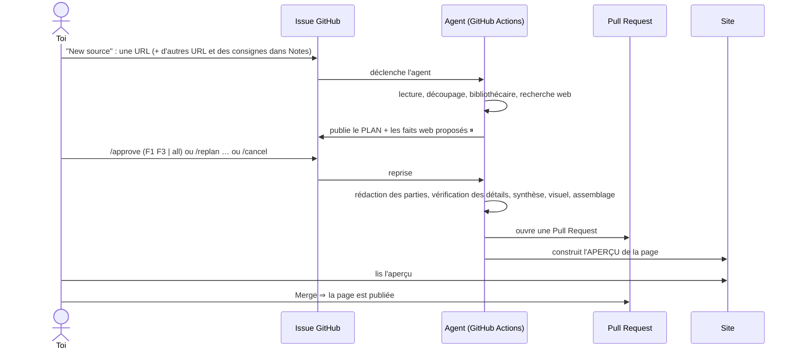
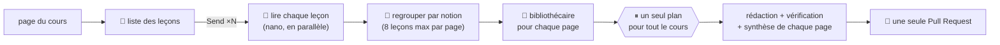

# L'agent du Carnet IA : comment il est construit

Cet agent transforme une ou plusieurs pages web (article, leçon, documentation, ou un cours entier) en **fiches** pour le site Carnet IA. Il est découpé en **rôles**, chacun avec une seule mission et une consigne courte, et **deux validations humaines** encadrent tout : le plan avant d'écrire, l'aperçu avant de publier.

Ce document explique exactement comment il est construit. Chaque élément renvoie au fichier où il est codé.

---

## 1. Le parcours d'une source



---

## 2. Les rôles

```mermaid
flowchart LR
    F["🔧 fetch<br/>lire + découper"] --> L["🧠 1. bibliothécaire<br/>où ranger, quelles parties"]
    L --> R["🧠 6. recherche web<br/>faits PROPOSÉS"]
    R --> H{{"⏸ tu valides<br/>plan + faits"}}
    H --> W["🧠 2. rédacteurs<br/>une partie chacun,<br/>en parallèle"]
    W --> C["🧠 3. vérificateur<br/>détails oubliés ?"]
    C --> E["🧠 4. éditeur<br/>In 30 seconds, notions,<br/>Remember, questions"]
    E --> I["🧠 7. illustrateur<br/>visuel SVG,<br/>validé par le code"]
    I --> M["🔧 assemblage<br/>insère dans la page"]
    M --> P["🔧 5. Pull Request<br/>+ aperçu web"]
```



| # | Rôle | Type | Ce qu'il reçoit | Ce qu'il produit | Modèle par défaut | Où |
|---|---|---|---|---|---|---|
| — | **fetch** | 🔧 code | les URL | le texte des sources, **découpé en morceaux numérotés** [C1], [C2]… (environ 300 mots chacun) | — | `article.py` → `fetch`, `chunks.py` |
| 1 | **Bibliothécaire** | 🧠 | les morceaux + la carte du site (sections, pages et leurs parties) | un `ArticlePlan` : où ranger (créer / compléter, thème, section) et **les parties à écrire** (4 max), chacune avec **ses numéros de morceaux**, son exemple, son visuel. Il n'écrit aucun contenu. | gpt-5.4-mini | `article.py` → `librarian` |
| — | vérification du plan | 🔧 code | le plan | rangement vérifié, numéros de morceaux valides, « compléter » seulement des parties qui existent, **chaque morceau utilisé** par une partie, 4 parties max | — | `core.py` → `validate_route`, `article.py` → `check_sections` |
| 6 | **Recherche web** | 🧠 + 🔧 | le plan (pas la source) | des **faits proposés**, numérotés F1, F2…, chacun avec sa source. Le code retire les URL inventées et le site lui-même. **Rien n'est ajouté sans ton accord.** | gpt-5.4-nano | `article.py` → `research` |
| ⏸ | **Ta validation** | toi | le plan affiché sur l'issue | `/approve`, `/approve F1 F3`, `/approve all`, `/replan …`, `/cancel` | — | `hitl.py` |
| 2 | **Rédacteur** (un par partie) | 🧠 | **seulement les morceaux de sa partie**, le plan de la page, les faits approuvés, le guide de style, et la partie existante s'il la complète | le texte de **sa** partie | gpt-5.4-mini | `article.py` → `write_part` |
| 3 | **Vérificateur** | 🧠 | la partie écrite + **ses** morceaux | la liste des détails importants oubliés. S'il y en a, le rédacteur les **ajoute** en une seule passe ciblée (pas de réécriture complète). | gpt-5.4-nano | `article.py` → `write_part` |
| 4 | **Éditeur** | 🧠 | les titres et débuts des parties (pas leur texte complet) | « In 30 seconds » (3 puces de 25 mots max), 3 ou 4 notions, « Remember » (3 à 5 puces), 2 ou 3 questions « Check yourself », la légende du visuel | gpt-5.4-mini | `article.py` → `edit` |
| 7 | **Illustrateur** | 🧠 + 🔧 | le titre, le thème, l'idée de visuel du plan, les 3 puces, les titres des parties (**jamais la source**) | un SVG `assets/visuals/<slug>.svg`, validé par le code. Un nouvel essai s'il est refusé, sinon pas de visuel et un avertissement dans la PR. En mise à jour, le visuel existant est gardé, sauf si le plan dit `visual: new`. Pas de visuel pour une carte d'outil. | celui de l'éditeur | `article.py` → `illustrate`, `illustrator.py` |
| — | **Assemblage** | 🔧 code | la page existante + les nouvelles parties | la page finale, dans l'ordre visuel → In 30 seconds → notions → parties → Remember → Check yourself → Sources (un ancien `.tldr` devient `.in30`) : les parties **insérées à leur place**, les autres **gardées à l'identique**, les sources fusionnées | — | `article.py` → `assemble` |
| 5 | **Publication** | 🔧 code | la page | une branche, une Pull Request, et l'**aperçu** de la page sur le site | — | `publish.py` |

Les rédacteurs des différentes parties travaillent **en parallèle** (un fil d'exécution par partie), d'où une page écrite en quelques dizaines de secondes.

**La règle partout** : *si l'étape doit toujours avoir lieu → code ; si elle demande de comprendre ou de juger → LLM.*

---

## 3. Pourquoi ce découpage coûte peu et garde les détails

| Avant | Maintenant |
|---|---|
| Le rédacteur recevait **toute** la source pour écrire **toute** la page | Chaque rédacteur ne reçoit **que ses morceaux** |
| Le relecteur relisait toute la page contre toute la source, puis **3 brouillons complets** | Le vérificateur compare **une partie avec ses morceaux** ; les oublis sont **ajoutés**, pas réécrits |
| Un LLM fusionnait l'ancienne page avec la nouvelle | **Le code** insère les parties ; l'éditeur ne voit que les débuts des parties |
| La recherche web s'ajoutait toujours | Elle est **proposée**, et ajoutée seulement si tu l'approuves |
| Un seul modèle partout | **nano** pour les tâches simples, **mini** là où la qualité compte |

Résultat mesuré sur la même source (le guide LLM-as-a-judge de Hugging Face) :

| | Ancienne version | Nouvelle version |
|---|---|---|
| Coût | 0,141 $ | **0,034 $** |
| Durée | 94 s | **37 s** |
| Longueur | 1 770 mots | 1 786 mots |
| Détails de la source | présents | présents |

**Garde-fous** : le coût de chaque exécution est compté (`run.py` → `Budget`) et affiché dans le plan et la Pull Request. Au-delà de **0,50 $** par article ou **3 $** par cours (`CARNET_MAX_COST`, `CARNET_MAX_COST_COURSE`), l'agent s'arrête et te le signale sur l'issue.

---

## 4. Ta validation (human in the loop)

### Le plan

Le commentaire affiché sur l'issue contient :
- la **décision** : créer ou compléter, quel fichier, quel thème, quelle section (⚠️ si une nouvelle section est proposée) ;
- les **parties**, avec ce qu'elles couvrent, leur exemple 💡, leur visuel 🎨, et si elles **complètent** une partie existante ou s'ajoutent ;
- les **faits web proposés**, F1, F2…, avec leurs sources ;
- le coût de la planification.

### Tes réponses

| Réponse | Effet |
|---|---|
| `/approve` | écrit la page, **sans** les faits web |
| `/approve F1 F3` | écrit, avec les faits F1 et F3 |
| `/approve all` | écrit, avec tous les faits proposés |
| `/approve` puis des consignes sur les lignes suivantes | écrit en suivant aussi les consignes |
| `/replan` + consignes | refait le plan, par exemple `/replan put it in agents, memory` |
| `/cancel` | arrête, rien n'est écrit |

Seul le propriétaire du dépôt peut piloter l'agent.

### Comment la pause marche techniquement

Le plan et la rédaction ont lieu dans **deux exécutions GitHub Actions séparées**.
1. **Pause** : le graphe est compilé avec `interrupt_before=["human_approval"]` et un checkpointer.
2. **Sauvegarde** : le plan, les faits proposés et une **empreinte de chaque morceau** sont compressés et cachés dans le commentaire. **Le texte des sources n'est pas sauvegardé**, il est relu à la reprise. Les morceaux sont retrouvés grâce à leurs empreintes, même si la page a un peu changé entre-temps (`chunks.py` → `remap`).
3. **Reprise** : `update_state(config, état, as_node="human_approval")`, puis `stream(None, config)`, comme dans la leçon *Human in the Loop* (`run.py` → `resume`).

### L'aperçu avant publication

Après avoir ouvert la Pull Request, l'agent relance la construction du site. Le workflow `publish.yml` construit le site normal **et** chaque Pull Request ouverte par l'agent, sous `…/carnet-ia/preview/pr-<numéro>/`. L'agent commente la Pull Request avec le lien direct vers la page. Tu la lis telle qu'elle sera publiée, puis tu fusionnes ou tu fermes.

---

## 5. Plusieurs sources, un cours entier

**Plusieurs URL dans une issue** (champ URL + autres URL dans Notes) : elles sont lues ensemble et découpées en morceaux. Un morceau ne mélange jamais deux sources. Le reste du texte des Notes devient une consigne pour toutes les étapes.

**Un cours DeepLearning.AI** (une seule URL, la page du cours) passe en **mode cours** (`course.py`) :



- Les **transcripts** sont isolés du reste de la page par le code. Les labs (accès connecté), les quiz et les leçons sans transcript lisible sont écartés.
- Les faits web proposés sont numérotés par page : `P2.F1` est le fait 1 de la page 2.
- **Limite** : le code des labs n'est pas lisible depuis l'extérieur. **Donne un cours par issue.**

---

## 6. Concept ou outil : la Toolbox

Le bibliothécaire **classe chaque source** (`ArticlePlan.source_kind`) :

| Type | Exemple | Ce que l'agent produit |
|---|---|---|
| **concept** | un guide sur le LLM-as-a-judge | une page dans le thème concerné |
| **tool** | la documentation de NVIDIA NeMo Agent Toolkit | une **fiche outil** dans la Toolbox, jamais dans une section concept |
| **mixed** | un cours qui enseigne la fiabilité avec le toolkit de NVIDIA | une page concept **neutre** + une **fiche outil** (deuxième appel du bibliothécaire, dans la même exécution, la même validation et la même Pull Request) |

**Une fiche outil a toujours le même format** : un tableau d'identité écrit par le code (éditeur, open source et licence, thèmes, concepts mis en œuvre, documentation), puis 4 parties fixes : *What it is*, *What it does*, *How to use it*, *When to use it*. Elle est étiquetée avec les thèmes qu'elle touche, ce qui permet de filtrer le catalogue par thème.

**Les pages concepts restent neutres** (règle du guide de style). Le code ajoute sur chaque page concept qu'un outil met en œuvre un encadré **« In practice: tools »** avec un lien vers sa fiche (`site.py` → `add_in_practice`). Seules les pages qui existent vraiment sont retenues.

Pour un **cours** construit autour d'un produit, le plan de cours prévoit une page pour ce produit dans la Toolbox, et garde les autres pages sur les concepts.

## 7. La carte du site et le rangement

Chaque page thème déclare ses sections, avec un identifiant et une description :

```markdown
## Foundation models {.group-title data-folder="foundation-models"}

::: {.group-meta}
The large proprietary models (GPT, Claude, Gemini…): what each family is good at, how they compare.
:::
```

`site.py` → `describe_site` donne au bibliothécaire **toutes** les sections, vides comprises, leurs pages, **et les grandes parties de chaque page**. C'est ce qui lui permet de proposer de **compléter** une partie existante plutôt que de dupliquer.

Une page qui existe déjà au même endroit avec le même titre est **mise à jour**, jamais dupliquée (`core.py` → `validate_route`).

**Pour ajouter ou décrire une section, modifie simplement la page thème** : l'agent en tient compte à la prochaine exécution. Une section vide porte la classe `.planned` (affichée « Coming soon »), retirée automatiquement quand elle reçoit sa première page.

---

## 8. Les sources : garanties par le code

- Chaque URL donnée devient une source principale.
- Les faits web ne sont utilisés **que s'ils sont approuvés**, et leur URL est alors ajoutée aux sources.
- Le code retire toute URL inventée (absente des résultats de recherche) et toute URL du site lui-même.
- La section Sources est générée par le code, jamais par un LLM. Lors d'une mise à jour, elle est **fusionnée** avec les sources existantes, sans doublons.

---

## 9. Les choix de modèles

Un modèle par rôle, modifiable par variable d'environnement, sans toucher au code (`config.py`) :

| Variable | Rôle | Par défaut |
|---|---|---|
| `CARNET_MODEL_READ` | lire les leçons d'un cours | `openai:gpt-5.4-nano` |
| `CARNET_MODEL_PLAN` | bibliothécaire, plan de cours | `openai:gpt-5.4-mini` |
| `CARNET_MODEL_WRITE` | rédiger les parties | `openai:gpt-5.4-mini` |
| `CARNET_MODEL_CHECK` | vérifier les détails | `openai:gpt-5.4-nano` |
| `CARNET_MODEL_EDIT` | In 30 seconds, notions, Remember, questions | `openai:gpt-5.4-mini` |
| `ILLUSTRATOR_MODEL` | dessiner le visuel de synthèse | celui de l'éditeur |
| `CARNET_MODEL_RESEARCH` | proposer des faits web | `openai:gpt-5.4-nano` |

DeepSeek fonctionne aussi (`deepseek:deepseek-flash`), avec la réflexion désactivée par le code. Avec l'ancienne architecture, il n'était pas moins cher, car il consommait plus de tokens. `CARNET_RESEARCH=0` désactive complètement la recherche web.

---

## 10. Ce que tu reconnaîtras des cours

| Concept | Où dans l'agent |
|---|---|
| `StateGraph`, nœuds, arêtes | `article.py` → `build`, `course.py` → `build` |
| Sorties structurées pour décider | `ArticlePlan`, `MissingDetails`, `Synthesis`, `CoursePlan` |
| Recherche agentique (Tavily) | `web.py` |
| Checkpointer, `interrupt_before`, `update_state`, `as_node` | `article.py` → `build`, `run.py` → `resume` |
| Map-reduce avec `Send` | `course.py` → `dispatch`, `read_lesson`, `plan_pages` |
| Routeur (niveau 2) | le bibliothécaire |
| Écrire puis vérifier (niveau 3) | rédacteur + vérificateur |
| Mémoire procédurale | `STYLE.md`, lu par chaque rédacteur |
| Mémoire sémantique | la carte du site (`describe_site`) |
| Évaluer un agent | les tests hors ligne, le comparatif de coût, les vérifications du code (`check_page`) |

---

## 11. Les fichiers

```
agent/
├── README.md            ← ce document
├── STYLE.md             ← guide de style, lu par chaque rédacteur (mémoire procédurale)
├── requirements.txt
├── carnet_agent/
│   ├── config.py        ← modèles par rôle, prix, plafond de coût, thèmes
│   ├── state.py         ← les sorties structurées (ArticlePlan, SectionPlan, Proposal, Synthesis…)
│   ├── prompts.py       ← une consigne courte par rôle
│   ├── article.py       ← l'agent : bibliothécaire → recherche → ⏸ → rédaction/vérification → éditeur → illustrateur → assemblage
│   ├── illustrator.py   ← le visuel de synthèse : consigne, validateur SVG, essai en local
│   ├── course.py        ← le mode cours (map-reduce sur les leçons)
│   ├── chunks.py        ← découpage en morceaux numérotés, empreintes
│   ├── core.py          ← services, réponses structurées réessayées, vérification du rangement
│   ├── site.py          ← opérations sur le site (code pur) : carte, parties, sources, menus, vérifications
│   ├── hitl.py          ← pause, sauvegarde/reprise, commandes /approve /replan /cancel
│   ├── web.py           ← lecture des pages et recherche Tavily
│   ├── publish.py       ← Pull Request + aperçu
│   └── run.py           ← point d'entrée, compteur de coût, plafond
└── tests/
    └── test_offline.py  ← tout l'agent avec de faux modèles : gratuit, sans clé
```

**Ordre de lecture conseillé** : `state.py` (les sorties structurées) → `article.py` (de haut en bas : chaque méthode est un rôle) → `run.py` (la pause et la reprise).

---

## 12. Lancer l'agent sur ton ordinateur (facultatif)

```bash
cd agent
pip install -r requirements.txt
python tests/test_offline.py                                        # gratuit, sans clé
python -m carnet_agent.run https://example.com/article --dry-run     # le plan s'affiche, tu réponds au clavier
```

Pour essayer **l'illustrateur seul** sur une fiche existante (un appel payant, rien n'est modifié dans le site) :

```bash
python -m carnet_agent.illustrator agents/memory/short-term-memory.qmd --out /tmp/test.svg
ILLUSTRATOR_MODEL=openai:gpt-5.4 python -m carnet_agent.illustrator agents/memory/short-term-memory.qmd
```

Le validateur ne voit pas les chevauchements ni les textes qui débordent d'une boîte : regarde toujours le visuel dans l'aperçu.

Il faut `OPENAI_API_KEY` et `TAVILY_API_KEY` dans l'environnement ou dans un fichier `.env`. `--dry-run` écrit la page dans ton dossier sans ouvrir de Pull Request.
