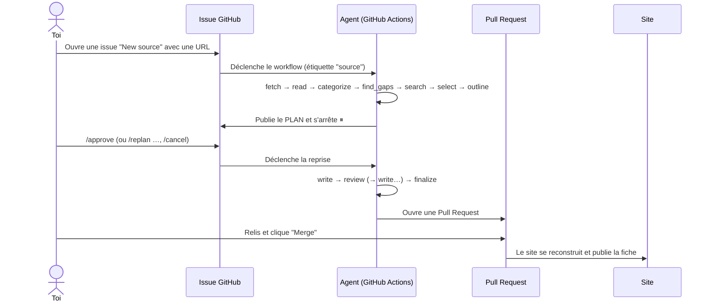
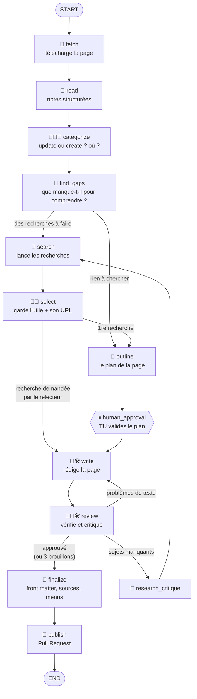

# L'agent du Carnet IA : comment il est construit

Cet agent transforme une page web (article, leçon, documentation…) en une **proposition de fiche** pour le site Carnet IA. Il lit la source, décide où la ranger, complète avec des recherches, **te montre son plan**, rédige, se relit, puis ouvre une **Pull Request**. Rien n'est publié sans ta validation.

Ce document explique **exactement** comment il est construit. Chaque concept renvoie au fichier et à la fonction où il est codé, et à la leçon du cours où tu l'as appris.

---

## 1. Le parcours d'une URL, du début à la fin



**Deux validations humaines** :
1. **Le plan**, avant que quoi que ce soit soit écrit : où va la page, son titre, ses sections, les compléments trouvés et leurs sources.
2. **La Pull Request**, avant la mise en ligne : le texte final, avec un résumé de ce que l'agent a fait.

### Plusieurs sources pour une même fiche

Dans le formulaire « New source », le champ **URL** reçoit la page principale. Le champ **Notes** peut contenir **d'autres URL sur le même sujet**, une par ligne, et des **consignes** :

```
https://docs.langchain.com/oss/python/langgraph/persistence
Focus on when to use which checkpointer in production.
```

- **Toutes les URL** de l'issue sont lues ensemble par `fetch`, et `read` en tire **un seul jeu de notes** : il fusionne ce qu'elles ont en commun, garde ce que chacune apporte, et en cas de désaccord garde la version la plus récente ou la plus fiable. Chaque URL devient une source principale, citée en bas de la page.
- **Le reste du texte** des notes devient une **consigne** pour toutes les étapes (rangement, recherche, plan, rédaction, relecture). Elle s'affiche dans le plan (📝) et s'ajoute aux consignes que tu donnes avec `/approve`.
- **Si une URL ne répond pas**, l'agent continue avec les autres.

(`hitl.py` → `parse_issue`, `graph.py` → `fetch`, `read`.)

---

## 2. Le graphe



Légende : 🔧 code Python · 🧠 appel LLM · 🛠️ tools que le LLM peut décider d'appeler · ⏸ pause humaine.

Le graphe est construit dans `carnet_agent/graph.py`, méthode `CarnetAgent.build()`.

---

## 3. Code, LLM ou tool : la règle

> **Si l'étape doit toujours avoir lieu → code.**
> **Si elle demande de comprendre ou de juger → appel LLM.**
> **Si c'est au LLM de décider s'il en a besoin → tool.**

| Nœud | Type | Ce qu'il fait | Où |
|---|---|---|---|
| `fetch` | 🔧 code | Récupère le texte de la page avec Tavily Extract (téléchargement simple en secours). Chaque site est différent : on ne lit pas le HTML nous-mêmes. | `graph.py` → `fetch`, `web.py` → `fetch_source` |
| `read` | 🧠 LLM | Transforme la ou les pages en `SourceNotes` : titre, résumé, idées clés, **détails à ne pas perdre** (chiffres, conditions, mises en garde, paramètres, étapes), **exemples de la source**, définitions, code. | `graph.py` → `read` |
| `categorize` | 🔧 → 🧠 → 🔧 | **Code** : construit la carte du site (thèmes → sections, même vides → pages). **LLM** : remplit un `Route` en suivant une procédure (notion → thème → section → page). **Code** : vérifie que la page et la section existent, et signale toute nouvelle section. Voir « Le routage » plus bas. | `graph.py` → `categorize`, `site.py` → `describe_site`, `list_sections` |
| `find_gaps` | 🧠 LLM | Liste ce qu'un apprenant ne comprendrait pas, et propose 3 recherches maximum (`ResearchPlan`), dont une pour trouver **un exemple réel** si la source en manque. | `graph.py` → `find_gaps` |
| `search` | 🔧 code | Lance les recherches Tavily et classe en premier les sites de confiance (docs officielles, papiers…). | `web.py` → `run_searches` |
| `select` | 🧠 → 🔧 | **LLM** : garde les informations utiles, chacune avec son URL (`Findings`). **Code** : supprime toute information dont l'URL n'était pas dans les résultats, ce qui empêche les sources inventées. | `graph.py` → `select` |
| `outline` | 🧠 LLM | Écrit le plan de la page (`PageOutline`) : pour chaque section, ses points, **son exemple concret** (et d'où il vient) et **son visuel**. C'est ce que tu valides. | `graph.py` → `outline` |
| `human_approval` | ⏸ | Ne fait rien : le graphe **s'arrête avant ce nœud** et attend ta réponse. | `graph.py` → `human_approval` |
| `write` | 🧠 + 🛠️ | Rédige la page. Reçoit **le plan approuvé (la structure)** et **le texte complet des sources (les détails)**, plus les notes de lecture, les compléments de recherche, tes consignes et des extraits des pages voisines. Consigne : le plan n'est pas une limite de contenu, il faut garder chiffres, conditions, mises en garde et exemples. Un exemple concret par section, au moins 3 types de visuels. Peut appeler `web_search` / `fetch_url`. | `graph.py` → `write`, `source_text`, `run_with_tools` |
| `review` | 🔧 → 🧠 + 🛠️ | **Code** : vérifications mécaniques (titre, sources, blocs bien fermés, longueur, au moins 3 types de visuels, au moins un exemple). **LLM** : relecture critique **en comparant avec le texte complet des sources** (fidélité, détails importants oubliés, API à jour, page concrète et visuelle), peut vérifier sur le web, rend un `Review`. | `graph.py` → `review`, `site.py` → `check_page` |
| `should_continue` | 🔧 code | Après la relecture : publier, réécrire, ou chercher plus. | `graph.py` → `should_continue` |
| `research_critique` | 🧠 LLM | Transforme les « sujets manquants » du relecteur en recherches. | `graph.py` → `research_critique` |
| `finalize` | 🔧 code | Assemble le fichier final : front matter, pastilles, texte, **section Sources**. Ajoute le dossier au menu si c'est un nouveau. | `graph.py` → `assemble`, `finalize`, `site.py` → `ensure_listed` |
| `publish` | 🔧 code | Crée une branche, un commit, une Pull Request. **Jamais un LLM** : on ne laisse pas un modèle décider d'écrire dans le dépôt. | `publish.py` |

### Les tools, en détail

Deux tools seulement, définis dans `web.py` → `make_tools()` :

- `web_search(query)` : une recherche web.
- `fetch_url(url)` : lire une page trouvée.

Ils ne sont donnés **qu'à** `write` et `review`. La boucle qui les exécute, `run_with_tools` dans `graph.py`, est la même que `take_action` dans le cours LangGraph :

```
le LLM répond → s'il demande un tool : on l'exécute, on renvoie le résultat → il répond à nouveau …
```

Elle s'arrête après 4 appels maximum (`MAX_TOOL_CALLS`).

### Le routage : comment l'agent choisit où ranger une page

C'est l'étape la plus importante pour la cohérence du site. Elle repose sur trois éléments.

**1. Une carte du site explicite.** Chaque page thème (`llms/index.qmd`, `agents/index.qmd`…) déclare ses sections avec un identifiant et une description :

```markdown
## Foundation models {.group-title data-folder="foundation-models"}

::: {.group-meta}
The large proprietary models (GPT, Claude, Gemini…): what each family is good at, how they compare.
:::
```

`site.py` → `list_sections` lit ces déclarations. Le routeur voit donc **toutes** les sections, **y compris les vides**, avec ce qu'elles doivent contenir, et les pages qu'elles ont déjà. **Pour ajouter ou modifier une section, il suffit de modifier la page thème : l'agent la verra à la prochaine exécution.**

**2. Une procédure en étapes, avec des exemples** (`prompts.py` → `CATEGORIZE`) :

```
1. Notion      : que m'apprend ce contenu ? (pas le titre de la source)
2. Thème       : comment marchent les modèles → llms, construire des agents → agents,
                 mesurer la qualité → evaluation, garde-fous → guardrails
3. Section     : celle dont la description correspond (une section vide est un bon choix)
4. Page        : une page couvre déjà la notion ? → la compléter (update), sinon créer
5. Nouvelle section : seulement si aucune ne convient (rare, à confirmer par un humain)
```

**3. Une vérification par le code**, après la décision du LLM :
- une mise à jour doit viser une page qui existe ;
- la section doit exister dans ce thème. Si le LLM a donné le **titre** au lieu de l'identifiant, le code retrouve l'identifiant ;
- sinon, c'est une **nouvelle section**, et le plan l'affiche avec un ⚠️ pour que tu la valides ou la corriges avec `/replan`.

---

## 4. L'état du graphe

Tout ce que l'agent sait circule dans un seul dictionnaire, `AgentState` (`state.py`) :

| Champ | Rempli par | Contenu |
|---|---|---|
| `url` | toi | La source |
| `raw_text` | `fetch` | Le texte complet des sources. Donné au rédacteur et au relecteur. Après une pause sur GitHub, il est retéléchargé, car il n'est pas sauvegardé dans le commentaire. |
| `notes` | `read` | `SourceNotes` |
| `route` | `categorize` | `Route` : la décision de rangement |
| `existing_body` | `categorize` | Le texte actuel de la page, si c'est une mise à jour |
| `gaps`, `queries` | `find_gaps` | Les manques et les recherches prévues |
| `search_results` | `search` | Les résultats bruts |
| `findings` ➕ | `select` | Les informations retenues, chacune avec son URL |
| `sources` ➕ | `read`, `select` | **Toutes** les sources : la source principale et les sources complémentaires |
| `outline` | `outline` | Le plan approuvé |
| `human_feedback` | toi | Tes consignes données avec `/approve` ou `/replan` |
| `draft` | `write` | Le texte de la page |
| `review`, `check_errors` | `review` | Le verdict du relecteur et les erreurs mécaniques |
| `revision_number` | `write` | Le nombre de brouillons écrits |
| `page_path`, `pr_url` | `finalize`, `publish` | Le résultat |

➕ = champ annoté avec `operator.add` : chaque recherche **ajoute** ses résultats au lieu de remplacer les précédents. C'est le même mécanisme que `messages` dans le cours. Les autres champs sont simplement **remplacés** à chaque mise à jour, ce qu'on veut pour `draft` ou `review`.

### Les sorties structurées

Le LLM ne répond jamais en texte libre quand on a besoin de **données**. Il remplit un modèle Pydantic grâce à `with_structured_output` :

`SourceNotes` · `Route` · `ResearchPlan` · `Findings` · `PageOutline` · `Review`

Tous sont dans `state.py`, avec une description de chaque champ. Ces descriptions font partie de la consigne donnée au modèle.

---

## 5. La validation humaine (human in the loop)

### En pratique

Après la recherche, l'agent publie un commentaire sur l'issue :

```
📝 Plan for: How to implement LLM guardrails
Decision: create guardrails/implementation/how-to-implement-llm-guardrails.qmd
Outline: …   Added from research: …   Sources: …
```

Tu réponds sur l'issue :

| Réponse | Effet |
|---|---|
| `/approve` | L'agent rédige la page comme prévu. |
| `/approve` puis des consignes sur les lignes suivantes | Il rédige en suivant aussi tes consignes. Exemple : *keep it short, add a comparison table*. |
| `/replan` + consignes | Il refait le rangement, la recherche et le plan avec tes consignes, puis te remontre un plan. Exemple : `/replan put it in agents, folder memory`. |
| `/cancel` | Il s'arrête et ferme l'issue. Rien n'est écrit. |

Seul **le propriétaire du dépôt** peut donner ces commandes : le workflow vérifie que `author_association == 'OWNER'`.

### Comment la pause fonctionne techniquement

C'est exactement la leçon *Human in the Loop*, avec une difficulté en plus : le plan et la reprise ont lieu dans **deux exécutions GitHub Actions séparées**, peut-être à plusieurs heures d'écart. La mémoire de la première exécution a disparu quand la seconde démarre.

1. **La pause** : le graphe est compilé avec `interrupt_before=["human_approval"]` et un checkpointer (`MemorySaver`). Il s'arrête juste avant ce nœud (`graph.py` → `build`).
2. **La sauvegarde** : l'état est compressé et caché dans le commentaire du plan, entre `<!-- carnet-agent-state … -->`. Il est invisible à l'affichage, mais présent dans le texte (`hitl.py` → `save_state`, `plan_comment`).
3. **La reprise** : la nouvelle exécution relit le dernier commentaire de plan (`hitl.py` → `latest_saved_state`), crée un graphe neuf et recharge l'état avec **`update_state(config, valeurs, as_node=…)`**, puis continue avec **`stream(None, config)`** (`run.py` → `resume`).

`as_node` décide **où** le graphe reprend :

| Commande | `as_node=` | Le graphe croit que ce nœud vient de finir, donc il continue avec… |
|---|---|---|
| `/approve` | `"human_approval"` | `write` |
| `/replan` | `"read"` | `categorize` → … → `outline` → nouvelle pause |

---

## 6. La boucle de relecture

C'est la boucle *generate → reflect* de l'**Essay Writer** :

```
write → review ─┬─ approuvé et aucune erreur mécanique ─────────→ finalize
                ├─ problèmes de texte ──────────────────────────→ write (avec la liste des problèmes)
                └─ sujets manquants → research_critique → search → select → write
```

Elle s'arrête au plus tard après 3 brouillons (`MAX_REVISIONS = 2` réécritures, dans `config.py`). Si la page n'est pas approuvée à ce moment-là, la Pull Request est quand même ouverte, avec les points restants listés pour que tu les vérifies.

---

## 7. Les sources : garanties par le code

Le LLM **n'écrit jamais** la section Sources lui-même :

1. Chaque information de recherche garde son URL (`Finding.source_url`).
2. `select` supprime toute URL qui n'était pas dans les vrais résultats de recherche.
3. `write` rédige le texte **sans** section Sources. Si le modèle en écrit une quand même, `clean_draft` l'enlève.
4. `finalize` génère la section à partir de `state["sources"]`. Pour une mise à jour, il **fusionne** avec les sources déjà présentes, sans doublons (`site.py` → `merge_sources`).
5. `review` vérifie par le code que chaque URL utilisée apparaît dans la section (`site.py` → `check_page`).

---

## 8. La mémoire de l'agent

Ce sont les trois types de mémoire du cours *Long-Term Agentic Memory* :

| Type | Ici | Où |
|---|---|---|
| **Procédurale** (les instructions) | `STYLE.md` : les règles d'écriture, relues à chaque exécution par `outline`, `write` et `review`. **Modifie ce fichier pour changer la façon d'écrire de l'agent, sans toucher au code.** | `agent/STYLE.md` |
| **Sémantique** (les faits) | L'index des pages du site, reconstruit à chaque exécution depuis les fichiers. C'est ce qui permet de décider « compléter » ou « créer ». | `site.py` → `list_pages`, `describe_site` |
| **Épisodique** (les exemples) | Pas encore. Idée : garder tes `/replan` et tes corrections de Pull Request comme exemples pour `categorize`. | |

---

## 9. GitHub : workflows, secrets, sécurité

| Fichier | Rôle |
|---|---|
| `.github/ISSUE_TEMPLATE/new-source.yml` | Le formulaire « New source ». Il ajoute l'étiquette `source`. |
| `.github/workflows/agent.yml` | Job `plan` (étiquette `source` ajoutée) et job `resume` (commentaire `/…` du propriétaire). |
| `.github/workflows/publish.yml` | Reconstruit et publie le site à chaque merge sur `main`. |

**Secrets nécessaires** (Settings → Secrets and variables → Actions) : `OPENAI_API_KEY` et `TAVILY_API_KEY`. Ils sont chiffrés par GitHub et n'apparaissent jamais dans le code ni dans les logs.

**Garde-fous** :
- L'agent n'écrit jamais sur `main` : il passe toujours par une branche et une Pull Request.
- Seul le propriétaire du dépôt peut piloter l'agent par commentaire.
- Le texte des issues est passé par variables d'environnement, jamais injecté directement dans une commande shell.
- Les chemins proposés par le LLM sont vérifiés par le code avant d'être utilisés.

---

## 10. Carte des fichiers

```
agent/
├── README.md               ← ce document
├── STYLE.md                ← guide de style (mémoire procédurale)
├── requirements.txt        ← dépendances Python
├── carnet_agent/
│   ├── config.py           ← modèles, limites, thèmes du site
│   ├── state.py            ← AgentState + sorties structurées (Pydantic)
│   ├── prompts.py          ← une consigne système par rôle
│   ├── graph.py            ← les nœuds, le graphe, la boucle de tools
│   ├── hitl.py             ← pause, sauvegarde/reprise de l'état, commandes
│   ├── site.py             ← opérations sur le site (code pur, sans LLM)
│   ├── web.py              ← fetch / search (code) et tools (pour le LLM)
│   ├── publish.py          ← branche, commit, Pull Request
│   └── run.py              ← point d'entrée (local ou GitHub)
└── tests/
    └── test_offline.py     ← le graphe complet avec de faux modèles, gratuit
```

**Ordre de lecture conseillé** : `state.py` → `graph.py` (commence par `build()`, puis chaque nœud) → `hitl.py` → `run.py`. Les autres fichiers sont des outils dont tu peux lire seulement les noms de fonctions.

---

## 11. Ce que tu reconnaîtras des cours

| Concept | Leçon | Dans l'agent |
|---|---|---|
| Boucle ReAct, tools | Build an Agent from Scratch / LangGraph Components | `run_with_tools` |
| `StateGraph`, nœuds, arêtes, arêtes conditionnelles | LangGraph Components | `build()` |
| Reducer `operator.add` | LangGraph Components | `findings`, `sources` |
| Recherche agentique (Tavily) | Agentic Search Tools | `web.py` |
| Checkpointer, threads | Persistence and Streaming | `MemorySaver`, `new_thread()` |
| Streaming des étapes | Persistence and Streaming | `run()` avec `stream_mode="updates"` |
| `interrupt_before`, `update_state`, `as_node`, `stream(None)` | Human in the Loop | `build()`, `resume()` |
| Plan → recherche → écriture → critique → révision | Essay Writer | `find_gaps` … `should_continue` |
| Sortie structurée pour router | Baseline Email Assistant | `Route` dans `categorize` |
| Mémoire procédurale et sémantique | Long-Term Agentic Memory | `STYLE.md`, `describe_site` |

---

## 12. Lancer l'agent sur ton ordinateur (facultatif)

```bash
cd agent
pip install -r requirements.txt
python tests/test_offline.py                                   # gratuit, sans clé
python -m carnet_agent.run https://example.com/article --dry-run
```

En local, le plan s'affiche dans le terminal et tu réponds `/approve`, `/replan …` ou `/cancel` au clavier. `--dry-run` écrit la page dans ton dossier sans ouvrir de Pull Request. Il faut `OPENAI_API_KEY` et `TAVILY_API_KEY`, dans l'environnement ou dans un fichier `.env`.

---

## 13. Coûts et limites

- **Coût** : environ quelques centimes par fiche avec `gpt-5.4-mini` (5 à 10 appels LLM et 3 à 6 recherches Tavily). Tu peux changer de modèle sans toucher au code, avec les variables `CARNET_MODEL` et `CARNET_REVIEW_MODEL`.
- **Pages inaccessibles** : celles qui demandent une connexion (comme le Jupyter des cours) ne peuvent pas être lues. Une vidéo sans transcript ne donne rien.
- **Pas d'exécution du code** : l'agent ne lance pas le code des fiches, il le relit seulement. C'est une raison de plus pour bien relire la Pull Request.
