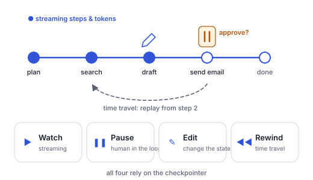

::: {.synthesis}
{fig-alt="Controlling a running agent: watch, pause, edit and rewind, on top of saved checkpoints"}
:::

::: {.in30}
- **Streaming** shows what the agent is doing while it runs, step by step or token by token.
- **Human in the loop** pauses it before sensitive steps so a person can approve, change or reject them.
- **Time travel** replays it from any earlier step. All of it relies on the checkpointer saving every step.
:::

::: {.concepts}
::: {.concept}
`stream()`

One event per step: the tool request, the tool result, then the final answer.
:::
::: {.concept}
`astream_events()`

One event per **token**, like a chat app typing. Asynchronous: use `async for`.
:::
::: {.concept}
`interrupt()`

Stops the graph wherever it is called; resuming with `Command(resume=…)` returns the person's answer.
:::
::: {.concept}
`update_state()`

Changes the state while the graph is paused. Each change is a new snapshot; nothing is erased.
:::
:::

## Watching: streaming

Two ways to stream: one event per step, or one event per token.

```python
for event in app.stream({"messages": messages}, thread):
    for update in event.values():
        print(update["messages"])

async for event in app.astream_events({"messages": messages}, thread, version="v2"):
    if event["event"] == "on_chat_model_stream":
        content = event["data"]["chunk"].content
        if content:                    # empty while the model is requesting a tool
            print(content, end="|")
```

::: {.example}
Asked about the weather in SF, `stream()` shows three steps: the model asks for `tavily_search`, the search result comes back, the model answers. `astream_events()` then shows the answer appearing word by word.
:::

## Pausing: human in the loop

```{mermaid}
flowchart LR
  S([START]) --> L[llm]
  L -- tool calls --> H{{"⏸ pause"}}
  H -- "approve" --> A[action]
  H -. "edit the call" .-> H
  L -- answer --> E([END])
  A --> L
```

**Pause before a node.** Compile with `interrupt_before`: the graph stops each time it is about to run that node.

```python
app = graph.compile(checkpointer=checkpointer, interrupt_before=["action"])

for event in app.stream({"messages": [HumanMessage(content="Weather in SF?")]}, thread):
    print(event)
app.get_state(thread).next          # ('action',): waiting before running the tool

for event in app.stream(None, thread):    # None = "continue": the search runs
    print(event)
```

**Pause from inside a node.** `interrupt()` stops the graph wherever it is called and returns the person's answer when the run resumes with `Command(resume=…)`. The pause can carry a question, and the answer can change what happens:

```python
from langgraph.types import interrupt, Command

def approve_search(state):
    decision = interrupt({"question": "Run this search?", "query": state["query"]})
    if decision == "no":
        return Command(goto=END)
    return {"query": state["query"] if decision == "yes" else decision}   # or a corrected query

app.invoke({"query": "weather SF"}, thread)           # pauses, returns the question
app.invoke(Command(resume="weather LA"), thread)      # resumes with the person's answer
```

## Editing: changing what the agent is about to do

While paused, the state can be changed with `update_state`. Each change is a **new snapshot**; nothing is erased.

::: {.example}
The agent is about to search for the weather in **LA**; you change it to **Louisiana** before it runs.
:::

```python
current = app.get_state(thread)
last = current.values["messages"][-1]
last.tool_calls = [{
    "name": "tavily_search",                              # the tool's real name
    "args": {"query": "current weather in Louisiana"},
    "id": last.tool_calls[0]["id"],                       # same id → replaces the message
}]
app.update_state(thread, current.values)
app.stream(None, thread)                                  # runs the edited search
```

Replacing a message requires a **reducer that replaces by id** instead of always appending:

::: {.code-step title="A reducer that replaces messages by id"}
```python
from uuid import uuid4

def reduce_messages(left: list, right: list) -> list:
    for message in right:
        if not message.id:
            message.id = str(uuid4())
    merged = left.copy()
    for message in right:
        for i, existing in enumerate(merged):
            if existing.id == message.id:
                merged[i] = message           # same id: replace
                break
        else:
            merged.append(message)            # new id: append
    return merged

class AgentState(TypedDict):
    messages: Annotated[list[AnyMessage], reduce_messages]
```
:::

**Answering in the agent's place.** With `as_node`, an update counts as the output of a given node. For example, inject a tool result yourself and skip the real tool:

```python
fake = ToolMessage(tool_call_id=call_id, name="tavily_search", content="54 degrees and sunny")
app.update_state(thread, {"messages": [fake]}, as_node="action")
app.stream(None, thread)                  # goes straight back to the llm node
```

## Rewinding: time travel

Every snapshot is kept. Resume from any of them, or edit an old one to explore a different branch; the original history stays intact.

```python
states = list(app.get_state_history(thread))      # newest first
earlier = states[-3]
for event in app.stream(None, earlier.config):    # replay from that point
    print(event)
```

::: {.example}
Rewind to the moment before the LA search, change the query to use AccuWeather, and resume: a new branch with a different answer, while the first run is still in the history.
:::

::: {.callout-tip}
## Remember
- Stream **steps** to show progress, stream **tokens** for a responsive answer.
- `interrupt_before=[node]` pauses before a node, `interrupt()` inside one; resume with `stream(None, thread)` or `invoke(Command(resume=…), thread)`.
- `update_state` never erases history; keep a message's **id** to replace it.
- `as_node` decides which node an update counts as, and therefore what runs next.
- The agent resumes from the **saved state**: change the state, not just your variables.
:::

<details class="quiz">
<summary>`stream()` or `astream_events()` to show an answer appearing word by word?</summary>

`astream_events()`: it emits one event per token. `stream()` emits one event per step.

</details>

<details class="quiz">
<summary>You edit a pending tool call with `update_state`. Why must you keep the call's `id`?</summary>

With a reducer that replaces by id, the same id replaces the old message instead of appending a new one.

</details>

<details class="quiz">
<summary>You rewind to an earlier snapshot and resume with a different query. What happens to the first run?</summary>

It stays in the history: the new run is a separate branch, nothing is erased.

</details>

## Sources {.sources}

- [AI Agents in LangGraph](https://learn.deeplearning.ai/courses/ai-agents-in-langgraph/), DeepLearning.AI × LangChain: lessons [Persistence and Streaming](https://learn.deeplearning.ai/courses/ai-agents-in-langgraph/lesson/nj9ok/persistence-and-streaming) and [Human in the loop](https://learn.deeplearning.ai/courses/ai-agents-in-langgraph/lesson/k87e1/human-in-the-loop)
