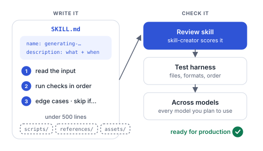

::: {.synthesis}
{fig-alt="Designing a custom skill: a short SKILL.md with name, description and ordered steps, extra files on the side, then review, test harness and checks across models"}
:::

::: {.in30}
- A skill is a `SKILL.md` with YAML frontmatter (name and description, used to trigger it), a body, and optional files.
- Write the body as a deterministic, numbered workflow with edge cases and skip conditions; move long material to scripts, references and assets.
- Before release, review the skill (for example with `skill-creator`), test it with a harness, and check it across models.
:::

::: {.concepts}
::: {.concept}
`SKILL.md structure`

A skill lives in a single `SKILL.md` file with YAML frontmatter, the main instructions, and optional links to supporting files. The frontmatter must include at least a name and description so the agent can identify the skill.
:::
::: {.concept}
`Predictable workflows`

The body of the skill should read like a deterministic sequence with explicit steps, edge cases, and skip conditions. The goal is to minimize guesswork and keep the main skill concise.
:::
::: {.concept}
`Progressive disclosure`

Use references and assets for long or specialized content instead of loading everything into the main file. This keeps `SKILL.md` focused on inputs, workflow, and outputs while loading extra material only when needed.
:::
::: {.concept}
`Skill evaluation`

Before production, test the skill for step order, output locations, and conventions like naming and formatting. Reviewing it with a dedicated review skill such as `skill-creator` helps catch problems early.
:::
:::

## Skill file structure

A skill lives in a `SKILL.md` file. It has three main parts:

- YAML frontmatter at the top
- the main body of the skill
- optional links to other files, like scripts, references, and assets

The frontmatter must include a **name** and a **description**. The body is where you write the skill instructions. If you need more material, you can keep it in other files and load it only when needed.

::: {.column-margin .watch}
Some skills, including ones built by Anthropic and others, do not follow the current specification exactly: the standard and the skill format are still evolving across providers and tooling. You may see different folder names or metadata in older or custom skills.
:::

### Name and description rules

The name and description help the agent decide **what the skill does** and **when to use it**.

- **Name**: use lowercase letters, numbers, and hyphens.
- The name usually works well as a **verb + `-ing`** form.
- **Description**: say what the skill does and when to use it.
- If certain keywords should trigger the skill, include them in the description.
- The name and description have character limits, so keep them short and clear.
- YAML frontmatter requires a name and a description, and these are mission-critical for both analysis and triggering: Claude uses them to detect when to use the skill.

### Optional files and folders

The standard supports optional directories such as:

- `scripts` for code to read and run
- `references` for extra documentation or long reference files
- `assets` for templates, images, logos, data files, and schemas

If references are quite long, it can be valuable to instruct the skill to read the entire reference file. Skills can also include optional metadata like license, compatibility, and arbitrary key-value pairs in your metadata.

::: {.example}
**Practice-question skill detection.** The first one is a generating practice questions skill, and it generates educational practice questions from lecture notes to test understanding. This was the first of two skills the instructor planned to run through the skill creator to evaluate for best practices and production readiness, so the example is tied directly to that evaluation context. A skill that generates educational practice questions from lecture notes uses a name and description tuned for detection. For example, its description can say that it generates practice questions from lecture notes to test understanding, so the agent knows both what it does and when to use it.
:::

```{mermaid}
flowchart TD
    A[SKILL.md] --> B[YAML frontmatter]
    A --> C[Main body]
    A --> D[Optional files]
    B --> E[Name]
    B --> F[Description]
    D --> G[scripts/]
    D --> H[references/]
    D --> I[assets/]
```

## Write predictable workflows

A skill body should read like a deterministic sequence. It should tell the model what to do, in order, with as little guesswork as possible. Use step-by-step instructions, name edge cases, and say clearly when a step can be skipped and why.

There are no underlying restrictions on the skill body format once you move past the YAML frontmatter; the guidance here is about making the workflow predictable, not imposing a strict format. Keep the main skill concise. A skill under 500 lines is a good practice, because you can put extra material in external files, scripts, references, or assets. For larger workflows, break the task into smaller sequential steps instead of one very large skill. That can include breaking complex workflows across multiple skills, not just within a single one.

### What makes a workflow predictable

- Use a fixed order.
- State the inputs, checks, and outputs.
- Describe edge cases explicitly.
- Give clear skip conditions.
- Keep the scope narrow.
- Use a low degree of freedom when you want consistent results.
- Allow more freedom only when the task really needs variation.
- Make the workflow work across many different environments.
- Use forward slashes for paths; that is mission critical even on Windows for portability.
- Include error handling and clear documentation for production-grade skills.
- When a reference file is long, it is often valuable to instruct the skill to read the entire file.

### Numbered workflow diagram

```{mermaid}
flowchart TD
    A[1. Read the input format] --> B[2. Run the required diagnostics]
    B --> C[3. Check edge cases and skip conditions]
    C --> D[4. Produce the required plots or outputs]
    D --> E[5. Read the summary file]
    E --> F[6. Present the final summary to the user]
```

::: {.steps}
1. **Read the input format**: Check the incoming data first. Make the expected columns, types, or file shape explicit.
2. **Run diagnostics in a fixed order**: Tell the skill exactly which script or checks to run, and in what sequence.
3. **Handle edge cases**: State what to do if data is missing, malformed, or incomplete.
4. **Skip only when allowed**: If a step can be skipped, explain the reason clearly.
5. **Produce outputs in a bounded scope**: List the exact files, plots, or text the skill should return.
6. **Summarize the result**: Read the final summary file or output and present only the relevant findings.
:::

::: {.example}
**Time-series diagnostics.** A time-series analysis skill starts by checking the input format, then runs diagnostics in a fixed order, then generates plots, reads `summary.txt`, and finally gives the user a short summary. The workflow is predictable because each step is named, ordered, and tied to a specific output.

In the earlier skill-creator analysis flow, this kind of example should also reflect running the skill through the skill-creator and checking best practices, not just showing the numbered workflow. If the workflow depends on a reference like `interpretation.md` for answering certain questions, that file should be included in the skill setup so the example is complete.

If the skill uses scripts, any Python dependencies should be called out explicitly, and the instructions should make it clear that they must be installed so the scripts run correctly.
:::

### Large-scale organization and standard directories

These systems can handle 100+ skills. Skills should be named appropriately, avoid confusion, and follow a predictable naming pattern so they are easy to find and use.

## Use references and assets

Use references and assets when a skill needs long supporting material, but you do not want to load it all into `SKILL.md` at once. This is progressive disclosure: keep the main skill file focused on the input, the workflow, and the output, then store large templates, domain examples, code, and other supporting material in separate files. The agent loads those files only when it needs them, only when necessary.

::: {.column-margin .define label="Supporting files"}
Large templates, examples, code, and other domain-specific resources belong in separate files. These can be pulled in selectively, which makes skills easier to maintain and faster to read.
:::

This is useful when you need:
- output templates for different formats, such as Markdown or LaTeX,
- domain-specific examples,
- longer guidance like `interpretation.md`,
- Python scripts for a fixed workflow,
- extra files that would make `SKILL.md` too large.

### Put large format templates in assets

If you need a specific output format, store the template in an asset file instead of copying every example into `SKILL.md`. In the source example, the skill uses assets for Markdown and LaTeX output templates for True/False question formatting, and the question generation order is explicit: True/False first, then progressing toward more realistic applications. The main file says what format to use, and the asset file shows exactly how a True/False question or an example should look.

This keeps the skill explicit without making the main file long. It also helps when the output depends on the user request.

### Put extra guidance in references

Use a references folder for supporting material such as domain examples or interpretation guidance. For example, the time-series skill points to an `interpretation.md` file for help when answering some time-series questions.

This works well when the main workflow is fixed, but the details of interpretation can live in a separate file.

### Put repeatable logic in scripts

If the skill needs a deterministic workflow, use scripts. The time-series example uses a visualization script and `diagnose.py` for plotting and diagnostics, including:
- plotting the time series,
- histogram,
- rolling stats,
- box plots,
- autocorrelation plots,
- decomposition,
- data quality checks,
- distribution checks,
- stationary tests,
- seasonality,
- trend,
- autocorrelation,
- transform recommendation.

The skill can then say to run a specific script first, in a fixed order, and end the diagnostics with a transform recommendation instead of describing every step in prose.

### Keep cross-environment details explicit

When a skill runs in different environments, be explicit about the details that affect whether files and scripts work.

Include:
- forward slashes in file paths,
- Python dependencies that the scripts need,
- optional directories or files, if the skill can still work without them,
- input column names and data types,
- any additional script flags or options if needed.

This matters because scripts depend on installed libraries, and the skill should highlight those dependencies clearly so the workflow runs correctly in each environment.

::: {.example}
**Markdown and LaTeX question templates.** A teacher builds a skill that generates comprehensive questions in a fixed order: True/False first, then other question types, ending with realistic applications. Instead of putting every Markdown and LaTeX example into `SKILL.md`, the skill stores output templates in `assets/` and links to them when needed. The main file stays short, while the agent loads only the template it needs for the current format.
:::

```{mermaid}
flowchart TD
    A[SKILL.md: input, workflow, output] --> B[Need long template?]
    B -->|Yes| C[Load assets/<format template>]
    B -->|Yes| D[Load references/<domain guidance>]
    B -->|Yes| E[Run scripts/<deterministic logic>]
    B -->|No| F[Keep working from SKILL.md]
    C --> G[Use only what is needed]
    D --> G
    E --> G
```

## Evaluate and refine skills

Before a skill goes into production, check that it behaves the way you expect. A good review looks at three things:

::: {.column-margin .watch}
A skill can look correct in one model and fail in another. Always check the output order, file paths, templates, and conventions, and test it across all the different models you’re planning to use before release.
:::

- the **order** of steps
- the **outputs** and file locations
- the **conventions** it follows, such as naming, formatting, and flags

A strong way to start is to run the skill through a **review skill** such as `skill-creator`. In the source example, the reviewer skill was used in Claude Code with `skill-creator` installed via the `anthropic/skills` marketplace, then verified after restarting Claude Code with the `/skills` command. It used **two sub-agents in parallel** to inspect two custom skills at the same time: **generating practice questions** and **analyzing time series**. The review found best-practice issues and gave scores and suggestions, such as improving conciseness for the question skill.

### How to evaluate a skill

::: {.steps}
1. **Run a skill review**: use a skill like `skill-creator` to check the skill’s `SKILL.md` and related files as part of the underlying evaluation process, using best practices out of the box.
2. **Inspect the results**: look for problems in ordering, output structure, frontmatter, duplication, and conciseness.
3. **Test the behavior**: try realistic inputs and check that the skill writes the right files, in the right format, with the right templates.
4. **Check the workflow order**: make sure the steps happen in the intended sequence, including optional steps when needed.
5. **Get human feedback**: ask a person to review the outputs.
6. **Test across models**: if you plan to use more than one model, check the skill across all the different models you’re planning to use.
:::

### Build a test harness

A **test harness** is a small setup that checks a skill like a unit test for software. Use it to confirm expected inputs, outputs, and file structure.

For the **generating practice questions** skill, the source suggests testing queries that save outputs to a:

- Markdown file
- LaTeX file
- PDF

Then verify that:

- the correct files are passed in
- the correct libraries are used for PDF input
- learning objectives are extracted as we specified
- the skill generates the right kinds of questions
- the correct output structure is used
- the output templates in the assets folder are used
- human feedback is gathered
- the skill is tested across models
- LaTeX compiles successfully
- the final questions are saved to the correct files and formats

For the **analyzing time series** skill, the source suggests testing that:

- the Python scripts already work with traditional unit tests
- the workflow runs in the correct order
- when plotting is requested, the optional plotting step is included
- the skill returns a summary and interpretation
- the final folder contains all required files in the right place

::: {.example}
**Reviewing two skills before release.** A reviewer skill scores the question-generation skill and the time-series skill. The review checks best practices first, then a harness checks that question outputs go to the expected Markdown, LaTeX, or PDF files, and that the time-series workflow runs in the right order and produces the required folders and files.
:::

::: {.compare}
::: {.col .bad}
**Without review and tests**

You may miss ordering mistakes, wrong output formats, missing files, or broken conventions.
:::

::: {.col .good}
**With review and tests**

You can score the skill, inspect its outputs, check file formats and order, and confirm the skill behaves as expected before production.
:::
::: 

::: {.callout-tip}
## Remember
- Keep `SKILL.md` focused and structured.
- Write instructions as an ordered workflow, not a vague guide.
- Use extra files for heavy or optional content.
- Make skip conditions and edge cases explicit.
- Test the skill before shipping it.
:::

## Sources {.sources}

- [Lesson: Creating custom skills](https://learn.deeplearning.ai/courses/agent-skills-with-anthropic/lesson/txwyf5/creating-custom-skills)
- [Lesson: Skills with claude code](https://learn.deeplearning.ai/courses/agent-skills-with-anthropic/lesson/cniu9b/skills-with-claude-code)
