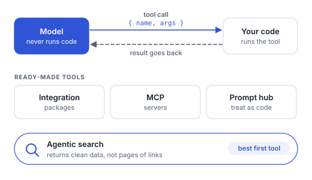

::: {.synthesis}
{fig-alt="Tool calling: the model emits a structured call, your code runs it; tools come from packages, MCP servers and hubs; agentic search"}
:::

::: {.in30}
- The model never runs a tool: it returns a **tool call** (name and arguments), your code runs it and sends the result back.
- Before writing a tool, look for one: **integration packages**, **MCP servers** and **prompt hubs** already cover a lot.
- **Agentic search** gives an agent fresh facts and sources to cite, as clean data instead of pages of links.
:::

::: {.concepts}
::: {.concept}
`@tool`

Turns a Python function into a tool. Its name, type hints and docstring become the description the model reads.
:::
::: {.concept}
`bind_tools`

Tells the model which tools exist. Without it, the model can't call them.
:::
::: {.concept}
`tool_calls`

What the model returns when it wants a tool: a list of `{name, args, id}`.
:::
::: {.concept}
`ToolMessage`

The result sent back to the model, linked to the call by `tool_call_id`.
:::
:::

## How tool calling works

```{mermaid}
sequenceDiagram
  participant Code as Your code
  participant LLM
  participant Tool
  Code->>LLM: messages + list of available tools
  LLM-->>Code: AIMessage with tool_calls [{name, args, id}]
  Code->>Tool: run name(args)
  Tool-->>Code: result
  Code->>LLM: ToolMessage(result, tool_call_id=id)
  LLM-->>Code: final answer (no tool_calls)
```

### Writing a tool

::: {.code-step title="A tool, its description and its arguments"}
```python
from langchain_core.tools import tool
from langchain_openai import ChatOpenAI

@tool
def check_calendar_availability(day: str) -> str:
    """Check calendar availability for a given day."""
    return f"Available times on {day}: 9:00 AM, 2:00 PM, 4:00 PM"

check_calendar_availability.name          # 'check_calendar_availability'
check_calendar_availability.description   # 'Check calendar availability for a given day.'
check_calendar_availability.args          # {'day': {'title': 'Day', 'type': 'string'}}

model = ChatOpenAI(model="gpt-5.4-mini").bind_tools([check_calendar_availability])
```
:::

The model only ever sees those three things: **name, description, arguments**. The docstring is the tool's user manual.

::: {.compare}
::: {.col .bad}
**Vague**

```python
@tool
def cal(d: str) -> str:
    """Calendar."""
```

The model can't tell when to call it, or what `d` should look like.
:::
::: {.col .good}
**Clear**

```python
@tool
def check_calendar_availability(day: str) -> str:
    """Check calendar availability for a given day,
    e.g. 'Tuesday' or '2026-11-17'."""
```

The name says what it does, the docstring says when and how.
:::
:::

::: {.example}
Asked *"Am I free on Tuesday?"*, the model doesn't answer from memory. It replies with a tool call, your code runs it, and the model answers from the result:

```python
reply = model.invoke("Am I free on Tuesday?")
reply.tool_calls
# [{'name': 'check_calendar_availability', 'args': {'day': 'Tuesday'}, 'id': 'call_…'}]
```
:::

### Parallel and sequential calls

The model can ask for several tools in one turn when the calls are independent, and spread them over several turns when one depends on another.

```{mermaid}
flowchart LR
  subgraph P["Parallel: one turn"]
    direction TB
    Q1["Weather in SF and LA?"] --> A1[search SF] & A2[search LA]
  end
  subgraph S["Sequential: two turns"]
    direction TB
    Q2["2024 Super Bowl winner,<br/>and its state's GDP?"] --> B1[search winner] --> B2[search GDP of that state]
  end
```

This is why the code that runs tools must **loop over all `tool_calls`**, not just the first one.

## Ready-made tools and prompts

Before writing a tool, check whether it already exists. There are three places to look.

```{mermaid}
flowchart LR
  A[Your agent] --> W["Write your own<br/>@tool"]
  A --> I["Integration packages<br/>langchain-tavily, langchain-exa…"]
  A --> M["MCP servers<br/>via langchain-mcp-adapters"]
```

### Integration packages

LangChain lists hundreds of tool integrations by category. Each comes from its own package, maintained close to the service it connects to.

| Category | Examples (package) |
|---|---|
| Search | Tavily (`langchain-tavily`), Exa (`langchain-exa`), Perplexity (`langchain-perplexity`) |
| Web browsing | Firecrawl (`langchain-firecrawl`), Hyperbrowser (`langchain-hyperbrowser`) |
| Productivity | Gmail and Google Calendar toolkits (`langchain-google-community`) |
| Code interpreter | Bedrock AgentCore Code Interpreter (`langchain-aws`) |
| Database | MCP Toolbox for databases (`toolbox-langchain`) |

A **toolkit** is a set of tools meant to be used together: the Gmail toolkit, for example, gives an agent tools to search, read, draft and send emails in one go.

::: {.example}
Every integration follows the same tool interface, so switching provider is a one-line change. The research agent from [Building agents with LangGraph](building-agents-with-langgraph.qmd) can swap its search engine without touching the graph:

```python
from langchain_tavily import TavilySearch
from langchain_exa import ExaSearchResults

tools = [TavilySearch(max_results=4)]        # or: [ExaSearchResults(…)]
agent = create_agent("openai:gpt-5.4-mini", tools=tools)
```
:::

::: {.callout-warning}
## `langchain-community` is retired
Many tutorials, including older courses, import tools from `langchain_community`, a package that once gathered *"hundreds of tools"*. It was sunset in May 2026 and its repository is archived. Use the dedicated package instead: `from langchain_tavily import TavilySearch` rather than `from langchain_community.tools.tavily_search import TavilySearchResults`.
:::

### MCP servers

The **Model Context Protocol** (MCP) is a standard way for a service to expose tools to any AI application. Instead of a Python package per service, the agent connects to a server and loads its tools.

```python
from langchain_mcp_adapters.client import MultiServerMCPClient

client = MultiServerMCPClient({
    "math": {"command": "python", "args": ["math_server.py"], "transport": "stdio"},       # local server
    "docs": {"url": "https://example.com/mcp", "transport": "streamable_http"},          # remote server
})
tools = await client.get_tools()             # regular LangChain tools
agent = create_agent("openai:gpt-5.4-mini", tools=tools)
```

### Prompts from the LangChain Hub

Prompts can be shared too. The **LangChain Hub**, now part of LangSmith, hosts prompts contributed by the community, addressed as `owner/name`.

::: {.column-margin .watch}
**Treat a pulled prompt as code.** A prompt manifest can carry model settings and references that are loaded when it is pulled. LangSmith's own documentation says pulled prompts should be treated as **executable configuration, not plain text**: only pull public prompts from authors you trust, and pin a version.
:::

::: {.example}
The hand-written ReAct prompt from [What is an agent](what-is-an-agent.qmd) has a well-known public equivalent, `hwchase17/react`. It starts with *"Answer the following questions as best you can"* and leaves the tools, the question and the agent's previous steps as variables to fill in:

```python
from langsmith import Client

prompt = Client().pull_prompt("hwchase17/react", dangerously_pull_public_prompt=True)
prompt.input_variables          # e.g. ['agent_scratchpad', 'input', 'tool_names', 'tools']
```
:::

::: {.steps}
1. **Pull** a prompt with `Client().pull_prompt("owner/name")`. Public prompts need `dangerously_pull_public_prompt=True`.
2. **Pin** a version by adding a commit after a colon, `"owner/name:abc123"`, so it can't change under you.
3. **Fill** its variables (`prompt.invoke({...})`) or chain it with a model.
:::

## Agentic search

A model only knows what it saw during training. Without search it has **no fresh information** (today's weather, last night's results) and **can't cite sources**, so its mistakes are harder to catch.

::: {.compare}
::: {.col}
**Regular search engine**

Returns links and raw HTML, built for a person reading a page. The agent still has to fetch, clean and extract each page.
:::
::: {.col .good}
**Agentic search (e.g. Tavily)**

Returns structured JSON, already filtered and ranked, built for a model. Ready to use as is.
:::
:::

Inside an agentic search tool, four steps happen before anything reaches your agent:

::: {.steps}
1. **Decompose**: split a complex question into sub-questions.
2. **Route**: send each to the best source; a weather question goes to a weather API.
3. **Extract**: chunk each source and keep the most relevant pieces (vector search).
4. **Score and filter**: rank the results and drop the weak ones.
:::

```python
from langchain_tavily import TavilySearch   # needs TAVILY_API_KEY

search = TavilySearch(max_results=4, include_answer=True)
result = search.invoke({"query": "What is in Nvidia's new Blackwell GPU?"})

result["answer"]                         # a short answer
[r["url"] for r in result["results"]]    # the sources, to cite
```

::: {.example}
Given `TavilySearch` as a tool and asked *"What's the weather in SF?"*, an agent calls `tavily_search` with `{"query": "current weather San Francisco"}`, receives temperature, conditions and sources as JSON, and answers in one sentence, citing where the numbers come from.
:::

::: {.callout-note .in-practice}
## In practice: tools
- [Anthropic skills ecosystem](../../toolbox/tools/anthropic-skills-ecosystem.qmd) (Anthropic): A set of pre-built skills for Claude, plus the public skills repository and the skill-creator workflow for creating or modifying skills.
- [Claude skills in APIs and SDKs](../../toolbox/tools/claude-skills-in-apis-and-sdks.qmd) (Anthropic / DeepLearning.AI course): A workflow for using Claude skills in the Messages API and the Claude Agent SDK, with file execution, file transfer, subagents, and MCP-backed writing.
:::

::: {.callout-tip}
## Remember
- The model **requests** tools, your code **runs** them. Name, type hints and docstring are the tool's manual.
- Loop over every `tool_calls` entry: calls can be parallel.
- Look before you write: **integration packages** (not the retired `langchain-community`), **MCP servers** and **prompt hubs** already cover a lot.
- Pin pulled prompts to a version and treat them as code.
- Agentic search gives agents fresh facts and citable sources, in a format made for models.
:::

## Sources {.sources}

- [AI Agents in LangGraph](https://learn.deeplearning.ai/courses/ai-agents-in-langgraph/)
- [LangGraph Components](https://learn.deeplearning.ai/courses/ai-agents-in-langgraph/lesson/l7rgk/langgraph-components)
- [Agentic Search Tools](https://learn.deeplearning.ai/courses/ai-agents-in-langgraph/lesson/oj6p9/agentic-search-tools)
- [Long-Term Agentic Memory with LangGraph](https://www.deeplearning.ai/courses/long-term-agentic-memory-with-langgraph)
- [Baseline Email Assistant](https://learn.deeplearning.ai/courses/long-term-agentic-memory-with-langgraph/lesson/a0k5a/baseline-email-assistant)
- [Tools and toolkits: integrations](https://docs.langchain.com/oss/python/integrations/tools)
- [Sunsetting langchain-community](https://github.com/langchain-ai/langchain-community/issues/674)
- [Manage prompts programmatically](https://docs.langchain.com/langsmith/manage-prompts-programmatically)
- [LangChain MCP adapters](https://github.com/langchain-ai/langchain-mcp-adapters)
- [Tavily documentation](https://docs.tavily.com)
