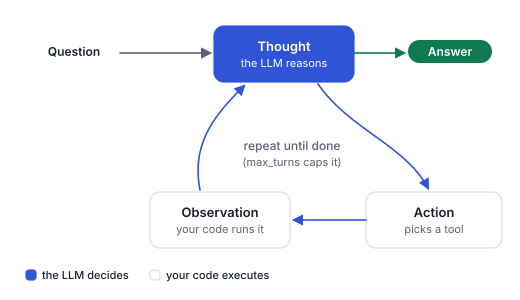

::: {.synthesis}
{fig-alt="The ReAct loop: Question, then Thought, Action, Observation repeated until an Answer"}
:::

::: {.in30}
- An agent is an LLM placed in a **loop**: it reasons, picks an action, and your code runs it.
- The result goes back to the model, which decides what to do next, until it has an answer.
- Everything else (frameworks, memory, human approval) is built on this one loop.
:::

::: {.concepts}
::: {.concept}
`Message history`

The agent's working memory: system prompt, user turns, model replies and observations, in order.
:::
::: {.concept}
`System prompt`

Defines the loop format and lists the available actions. A worked example in it makes the format reliable.
:::
::: {.concept}
`Tools`

Python functions the model can ask for. A dictionary maps each name to its function.
:::
::: {.concept}
`Turn limit`

A maximum number of iterations, so the loop can never run forever.
:::
:::

## The ReAct loop

**ReAct** stands for *Reasoning + Acting*. The model alternates between thinking about what to do and doing it.

::: {.column-margin .define label="ReAct"}
*ReAct: Synergizing Reasoning and Acting in Language Models*, Yao et al. (see the sources).
:::

::: {.example}
Asked *"What is the combined weight of a Border Collie and a Scottish Terrier?"*, the model looks up the first breed (37 lbs), then the second (20 lbs), then calls a calculator with `37 + 20`, and answers **57 lbs**. Three actions, chosen one after the other by the model.
:::

## Who does what

The model never runs anything itself. It only **decides**. The surrounding code, the *runtime*, does everything else.

::: {.column-margin .define label="Runtime"}
The code around the model: it reads the reply, runs the action, keeps the history.
:::

| The LLM | The runtime (your code) |
|---|---|
| Reasons about the question | Reads the model's reply |
| Chooses the next action and its input | Checks the action exists, runs it |
| Decides when it has the final answer | Sends back the observation, keeps the history, stops runaway loops |

## Building one by hand

Writing the loop yourself once shows that there is no magic.

::: {.column-margin .watch}
`eval()` in a demo calculator runs any Python code: never use it on untrusted input.
:::

::: {.code-step title="The agent keeps the conversation and calls the model"}
```python
from openai import OpenAI

client = OpenAI()

class Agent:
    def __init__(self, system=""):
        self.messages = [{"role": "system", "content": system}] if system else []

    def __call__(self, message):
        self.messages.append({"role": "user", "content": message})
        reply = client.chat.completions.create(model="gpt-5.4-mini", messages=self.messages)
        result = reply.choices[0].message.content
        self.messages.append({"role": "assistant", "content": result})
        return result
```
:::

::: {.code-step title="The prompt teaches the format. For example, with two tools"}
```text
You run in a loop of Thought, Action, PAUSE, Observation.
At the end of the loop you output an Answer.
Use Action to run one of the actions available to you, then return PAUSE.

Your available actions are:
calculate:            e.g. calculate: 4 * 7 / 3
average_dog_weight:   e.g. average_dog_weight: Collie

Example session:
Question: How much does a Bulldog weigh?
Thought: I should look the weight up using average_dog_weight
Action: average_dog_weight: Bulldog
PAUSE
Observation: A Bulldog weighs 51 lbs
Answer: A Bulldog weighs 51 lbs
```
:::

::: {.code-step title="The runtime parses the action, runs it, and loops"}
```python
import re

known_actions = {"calculate": calculate, "average_dog_weight": average_dog_weight}
action_re = re.compile(r"^Action: (\w+): (.*)$")

def query(question, max_turns=5):
    bot = Agent(prompt)
    next_prompt = question
    for _ in range(max_turns):
        result = bot(next_prompt)
        actions = [action_re.match(line) for line in result.split("\n") if action_re.match(line)]
        if not actions:
            return result                                   # no action: this is the answer
        name, action_input = actions[0].groups()
        if name not in known_actions:
            raise ValueError(f"Unknown action: {name}")
        observation = known_actions[name](action_input)
        next_prompt = f"Observation: {observation}"
```
:::

Parsing text with a regex is fragile. Modern models solve this with **native tool calling**: they return structured tool calls instead of text. See [Tools and agentic search](tools-and-agentic-search.qmd). Frameworks such as LangGraph then take care of the loop: see [Building agents with LangGraph](building-agents-with-langgraph.qmd).

::: {.callout-note .in-practice}
## In practice: tools
- [Anthropic skills ecosystem](../../toolbox/tools/anthropic-skills-ecosystem.qmd) (Anthropic): A set of pre-built skills for Claude, plus the public skills repository and the skill-creator workflow for creating or modifying skills.
:::

::: {.callout-tip}
## Remember
- Agent = LLM + loop + tools. The LLM **decides**, the code **executes**.
- The prompt is a contract between the model and the runtime.
- Always cap the loop and validate the action before running it.
:::

<details class="quiz">
<summary>Who actually runs the tool: the LLM or your code?</summary>

Your code. The model only returns which action to take and its input; the runtime checks it exists, runs it and sends back the observation.

</details>

<details class="quiz">
<summary>Why cap the loop with `max_turns`?</summary>

So a confused model can never loop forever, burning tokens and time.

</details>

## Sources {.sources}

- [AI Agents in LangGraph](https://learn.deeplearning.ai/courses/ai-agents-in-langgraph/)
- [Build an Agent from Scratch](https://learn.deeplearning.ai/courses/ai-agents-in-langgraph/lesson/c1l2c/build-an-agent-from-scratch)
- [A simple Python implementation of the ReAct pattern for LLMs](https://til.simonwillison.net/llms/python-react-pattern)
- [ReAct: Synergizing Reasoning and Acting in Language Models](https://arxiv.org/abs/2210.03629)
