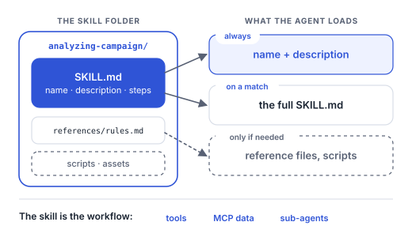

::: {.synthesis}
{fig-alt="A skill folder: SKILL.md with name and description always in context, full instructions loaded on a match, reference files only when needed"}
:::

::: {.in30}
- A skill is a reusable folder of instructions centred on a required `SKILL.md` file: a repeated workflow or specialised knowledge.
- The agent keeps only names and descriptions in context, and loads a skill's full instructions when a request matches.
- Skills are the workflow layer: they tell the agent how to combine tools, MCP data and sub-agents.
:::

::: {.concepts}
::: {.concept}
`Skill as a reusable folder`

A skill is not just a prompt; it is a folder that packages a repeated workflow or specialized knowledge for reuse. The core file is `SKILL.md`, which must include the skill name, description, and main instructions.
:::
::: {.concept}
`SKILL.md` as the entry point

`SKILL.md` is the main file of a skill and must be written in Markdown. It defines what the skill is for and gives the instructions the agent uses when the skill is activated.
:::
::: {.concept}
`Progressive disclosure`

Skills keep the context window lightweight by loading only the name and description up front. The full instructions in `SKILL.md`, and any extra files, are pulled in only when the user’s request matches the skill.
:::
::: {.concept}
`Skills in the agent stack`

Skills complement other agent components: tools provide capabilities, MCP provides external data and systems, and sub-agents handle isolated or parallel tasks. Skills tell the agent how to combine those pieces into a repeatable process.
:::
:::

## What a skill is

A skill is a folder of instructions that extends an agent with specialized knowledge or a repeated workflow. Instead of writing the same prompt again and again, you package the steps in a reusable folder. The agent can then use that skill when a user request matches its description.

A skill uses a `SKILL.md` file as its main file. This file must be named `SKILL.md` and written in Markdown. It contains:
- the skill name
- the description
- the main instructions

The `name` and `description` are required. They are usually written in YAML at the top of the file, and the YAML structure explicitly includes those fields. The main instructions can also point to other files, such as:
- extra Markdown files
- scripts
- assets like templates or images

These supporting files must be in the same parent folder as `SKILL.md`.

Skills are an open standard, which means they use a standardized format compatible with any skills-compatible agent. You can build a skill once and deploy it across multiple agent products.

To use a skill, an agent needs a basic tool set, including filesystem access to read and write files and a bash tool to execute code. Those tools let the agent run whatever commands the skill requires.

::: {.example}
**Weekly marketing campaign analysis.** A team wants to analyze campaign performance every week. The skill folder contains a `SKILL.md` file with the analysis workflow, plus a `budget_reallocation_rules.md` reference file that is only used when the user asks about budget reallocation. That file is not loaded generically; it is loaded only when the user specifically asks about Budget Reallocation.
:::

```{mermaid}
flowchart TD
    A[Skill folder] --> B[SKILL.md]
    A --> C[budget_reallocation_rules.md]
    B --> D[Name]
    B --> E[Description]
    B --> F[Main instructions]
    F --> C
```

## Progressive disclosure

Skills stay lightweight in the context window. The skill name and description are always present. The full instructions in `SKILL.md` are loaded only when the user request matches the skill description. If the skill needs more detail, it can also load other files, such as extra markdown files, scripts, templates, or images.

This is called **progressive disclosure**: the agent sees only the parts it needs, when it needs them. It helps avoid putting every instruction into the context window all the time. At that point, the agent may also load reference and asset files if needed.

::: {.example}
**Budget reallocation on demand.** A skill can include a note about budget reallocation in `SKILL.md`, and point to `budget_reallocation_rules.md`. Those rules are read only when the user asks about Budget Reallocation, not for every request. This is similar to a previous prompt that included input requirements, a data quality check, funnel analysis with specific metrics, and historical benchmarks.
:::

```{mermaid}
flowchart TD
    A[Skill name + description] --> B{Does the request match the skill description?}
    B -- No --> C[Do not load full instructions]
    B -- Yes --> D[Load SKILL.md instructions]
    D --> E{Does the skill reference extra files?}
    E -- No --> F[Use the loaded instructions]
    E -- Yes --> G[Load only the needed extra files]
    G --> F
```

## Why use skills

Skills help you package a repeated workflow into something you can reuse. Instead of pasting the same long prompt every time, you put the instructions in one place and use them again later. This is useful for work you do often, like weekly campaign analysis.

::: {.column-margin .define label="Reusable workflow"}
Skills are useful for tasks you do repeatedly because they let you store a long prompt once and use it again later. This makes recurring work easier to standardize, share, and update.
:::

Skills also help with portability. A skill is a folder with a `SKILL.md` file, and it can include extra reference files. You can upload that package to Claude AI and use it in later chats. Because skills are an open standard, the same skill can also be shared across other products and environments, such as Codex and Gemini CLI.

### Before and after

::: {.compare}
::: {.col .bad}
**Without a skill**

You paste the same weekly campaign-performance prompt every week. The prompt includes the CSV input, a data quality check, funnel analysis, benchmark metrics, efficiency metrics like return on ad spend, cost per acquisition, and net profit, plus budget reallocation rules. It also asks for a specific structured output format for the campaign analysis at the end of the prompt, and it adds to the context window every time.

The data quality check reports items like Total Records, Missing Data, and Anomalies. The budget reallocation rules are the part that require external documentation and specify the exact way decisions should be made, which means you need the right pre-existing knowledge on hand each time.
:::

::: {.col .good}
**With a skill**

You package that weekly campaign performance analysis workflow into a reusable skill, for example `analyzing-marketing-campaign`. It includes a `SKILL.md` file and a `references` folder with files like `budget_reallocation_rules`. Inside `SKILL.md`, there is a link specifically to `references/budget_reallocation_rules`.

You follow the skill-creation steps by naming the skill folder with lowercase letters and dashes, and avoiding reserved keywords like “Claude” or “Anthropic.” You then zip the folder and upload it in Claude AI through Settings → Capabilities → Skills, where you can add, upload, or drag and drop the zip file. Once uploaded, the skill appears with its name and description.

In a new chat, Claude can read the skill file to make sure it is following the right instructions, and then automatically read the referenced budget rules file during the conversation. You can even open and view the code or operations Claude runs behind the scenes if you want to inspect what is happening.

An example analysis with the skill can also cover additional channel challenges, such as TikTok, along with recommended reallocations. Because the workflow is packaged, you do not have to rewrite the same prompt every week, and only the useful instructions are added to the context window.
:::
:::

::: {.example}
**Weekly campaign analysis reused in Claude AI.** A marketing team has a CSV with date, campaign name, impressions, clicks, and conversions. They first ask Claude to check data quality, run funnel analysis, and report metrics. Later, they add budget reallocation rules and ask for recommendations. Instead of repeating that full prompt every week, they turn it into a skill, zip the folder, upload it to Claude AI, and reuse it in future conversations. The skill helps Claude read the instructions once, follow the right workflow, and apply the referenced budget rules automatically in future chats.
:::

## Skills with tools, MCP, and sub-agents

Skills sit in the middle of the agent ecosystem.

- **Tools** give an agent capabilities. They let it read and write files, run code, and access systems.
- **MCP** (Model Context Protocol) brings in external data and systems, like databases or Google Drive.
- **Sub-agents** handle isolated work or parallel work. They can run in their own context window with limited tool permissions.
- **Skills** provide the repeatable workflow. They tell the agent how to use tools, MCP data, and sub-agents in a predictable way.

Tool definitions live in the context window, while skills are loaded progressively when necessary (see Progressive disclosure).

Skills can also be combined with MCP and sub-agents to create workflows. For example, you can use MCP to get data from external sources, then use a skill to process that data or retrieve information efficiently. You can also delegate to a sub-agent with isolated context, and that sub-agent can use skills too.

### How they work together

```{mermaid}
flowchart LR
  U[User request] --> S[Skill]
  S --> T[Tools]
  S --> M[MCP servers]
  S --> A[Sub-agents]
  M --> D[External data and systems]
  T --> C[File access, code execution, other capabilities]
  A --> R[Isolated or parallel work]
  D --> S
  C --> S
  R --> S
```

- **Tools** are the lower-level capabilities.
- **MCP** supplies the data and resources the model does not know about.
- **Sub-agents** can work in parallel and return results to the main agent.
- **Skills** give the instructions for what to do with all of that.

::: {.example}
**Customer insight analyzer.** A main agent uses MCP to pull customer interview data from external systems. It sends interview and survey analysis to sub-agents so they can work in parallel. The skill defines the workflow for categorizing feedback, summarizing findings, and combining the results in a repeatable way.
:::

Sub-agents can persist across many sessions, while skills persist across conversations with the user and the application.

A few named examples from the course: a **Code Reviewer** sub-agent, marketing campaign workflows, content creation workflows, data analysis workflows, and the **skill creator** mention.

Skills are useful when you want a workflow to stay the same each time. If a task needs external data, special tools, or separate analysis threads, a skill can organize those pieces into one procedure.

::: {.callout-tip}
## Remember
- A skill is a reusable workflow, not just a prompt.
- `SKILL.md` is the required main file.
- Only the skill name and description stay in context by default; the full skill loads when the request matches it.
- Skills help standardize repeated work and stay portable.
- Skills guide how to use tools, MCP, and sub-agents.
:::

## Sources {.sources}

- [Lesson: Introduction](https://learn.deeplearning.ai/courses/agent-skills-with-anthropic/lesson/ldn5c3/introduction)
- [Lesson: Why use skills part i](https://learn.deeplearning.ai/courses/agent-skills-with-anthropic/lesson/bv2ekh/why-use-skills---part-i)
- [Lesson: Skills vs tools, mcp, and subagents](https://learn.deeplearning.ai/courses/agent-skills-with-anthropic/lesson/9iovmn/skills-vs-tools%2C-mcp%2C-and-subagents)
