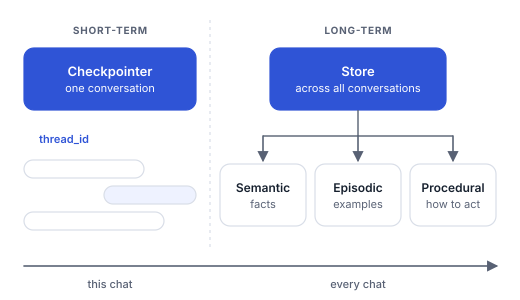

::: {.synthesis}
{fig-alt="Agent memory: short-term with the checkpointer, long-term with the store, split into semantic, episodic and procedural"}
:::

::: {.in30}
- **Short-term memory** keeps one conversation going: in LangGraph, the **checkpointer**, organised by `thread_id`.
- **Long-term memory** keeps what the agent learned across conversations: the **store**, organised by namespace.
- Long-term memories come in three kinds: **semantic** (facts), **episodic** (examples), **procedural** (instructions).
:::

::: {.concepts}
::: {.concept}
`Semantic`: facts

What the agent knows about people, places and things. *"Jim is John's friend."*
:::
::: {.concept}
`Episodic`: experiences

Past events and decisions, fed back as **few-shot examples**. *"An email like this one was ignored last time."*
:::
::: {.concept}
`Procedural`: skills

How to behave: for an agent, mostly **its prompt**. *"Always sign emails John Doe."*
:::
:::

## Two time scales, two mechanisms

```{mermaid}
flowchart LR
  subgraph T1["Thread 1 (Monday)"]
    A1[messages…] --> C1[(checkpointer)]
  end
  subgraph T2["Thread 2 (Friday)"]
    A2[messages…] --> C2[(checkpointer)]
  end
  A1 <--> S[("store<br/>facts · examples · instructions")]
  A2 <--> S
```

| | Short-term memory | Long-term memory |
|---|---|---|
| Remembers | One conversation | Everything learned about a user, across conversations |
| LangGraph mechanism | **Checkpointer** | **Store** |
| Organised by | `thread_id` | **Namespace**, e.g. `("email_assistant", user_id, "collection")` |
| Saves | The whole graph state, after every step | Individual memories you choose to write |
| Read by | Automatically, when a thread resumes | Explicitly: a node or a tool searches it |
| Set up with | `compile(checkpointer=…)` | `compile(store=…)`, or passed to an agent |
| Example | *"What about LA?"* understood after asking about SF | *"Jim is my friend"* remembered a week later |
| Details | [Short-term memory](short-term-memory.qmd) | [Long-term memory](long-term-memory.qmd) |

A real agent usually has **both**: the checkpointer for the conversation in progress, the store for what should outlive it.

## Three kinds of long-term memory

The categories come from how human memory works.

| The agent needs… | Use |
|---|---|
| Facts about people, places or things | Semantic memory |
| Concrete examples of the right decision | Episodic memory |
| Better instructions | Procedural memory |

All three live in the store. They differ in **what** is saved and **where it is used**: facts are searched by a tool, examples are inserted into a prompt as few-shot examples, instructions *become* the prompt.

## When to write memories

| | In the hot path | In the background |
|---|---|---|
| How | The agent saves memories itself, while it answers (with a memory tool) | A separate process, often a second agent, updates memory afterwards |
| Pros | Simple, memories available immediately | Faster replies, clear separation of concerns |
| Cons | More work for the agent, slower replies | Two components to run, memories arrive later |
| Typical use | Semantic facts mentioned by the user | Learning examples and instructions from feedback |

::: {.example}
**One email assistant, all memory types.** The response agent saves facts in the hot path ("Jim is my friend"). The triage step reads past decisions as examples. A background optimizer rewrites the prompts from the user's feedback. Each mechanism is shown in [Long-term memory](long-term-memory.qmd).
:::

::: {.callout-tip}
## Remember
- **Checkpointer** = short-term, per thread. **Store** = long-term, across threads.
- **Semantic** = facts, **episodic** = examples, **procedural** = instructions.
- Hot path = simple and immediate. Background = fast replies, delayed memories.
- These patterns apply to any agent, not just email.
:::

## Sources {.sources}

- [Long-Term Agentic Memory with LangGraph](https://www.deeplearning.ai/courses/long-term-agentic-memory-with-langgraph), DeepLearning.AI × LangChain, taught by Harrison Chase: lesson [Introduction to Agent Memory](https://learn.deeplearning.ai/courses/long-term-agentic-memory-with-langgraph/lesson/mp33x/introduction-to-agent-memory)
- [AI Agents in LangGraph](https://learn.deeplearning.ai/courses/ai-agents-in-langgraph/), DeepLearning.AI × LangChain: lesson [Persistence and Streaming](https://learn.deeplearning.ai/courses/ai-agents-in-langgraph/lesson/nj9ok/persistence-and-streaming)
