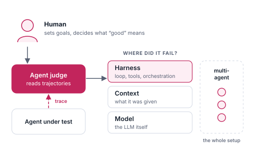

::: {.synthesis}
{fig-alt="Agent-based evaluation: a human sets goals, an agent judge reads trajectories, failures split into harness, context and model"}
:::

::: {.in30}
- Humans define what “good” means; agents do the heavy lifting: crawling traces, finding patterns and unknown unknowns, drafting evals.
- An agent judge reads the whole trajectory and can adapt its criteria, but a human still reviews and approves what ships.
- Locate failures in the model, the context or the harness, and change one layer at a time; multi-agent systems add coordination and cost.
:::

::: {.concepts}
::: {.concept}
`Human judgment sets the target`

Agents can assist with evaluation, but domain experts must define what “good” means for the business and the user experience. Human taste is especially important for subjective goals like reducing frustration or helping users reach the right outcome.
:::
::: {.concept}
`Agent-as-judge`

An agent judge evaluates another agent by looking at the full trajectory: steps, turns, reasoning path, and final output. Compared with a simple LLM judge, it can adapt criteria and make debugging more actionable.
:::
::: {.concept}
`Online evals and monitoring`

Evaluation continues after launch through live traffic, traces, and dashboards. Agents can help triage production data by grouping patterns and flagging suspicious cases, while humans still review the important ones.
:::
::: {.concept}
`Model, context, harness`

A bad agent outcome may come from the base model, the prompt/context, or the control system around it. Separating these layers helps engineers diagnose problems and avoid blaming the wrong part of the system.
:::
:::

## Human judgment and agent help

Human expertise still matters. Agents can do a lot more now, but a domain expert is still needed to decide what is truly good or bad for a business or a use case. That judgment helps define what the end-user experience should be.

Humans also set the target for the eval. For example, they may decide that the user should leave feeling less frustrated, or should reach the outcome they came for. That kind of taste is hard to automate. It is the basis for the first set of evals.

Agents can help with the heavy lifting. They can crawl large volumes of traces and telemetry data, find patterns, and spot common questions, common errors, and other signals in user behavior. Because the telemetry volume is so massive, they can run through those traces in a way that older observability approaches could not, since those relied on humans looking at dashboards, metrics, and logs. They can also find unknown unknowns: categories of issues you did not think to include in your evals.

Humans and agents work best together. The human defines what good means. The agent scans traces, drafts new evals, and continuously refines them over time based on newly arriving traces and human judgment, so it is not just a one-shot approach.

::: {.compare}
::: {.col .bad}
**Human judgment alone**

You decide what “good” means, but as telemetry grows, it becomes hard to keep up with dashboards, metrics, and logs. 
:::
::: {.col .good}
**Human judgment + agent help**

You use human taste to define the goal, like “the user should feel less frustrated.” Then agents crawl traces, look for patterns, and suggest new evals from signals you may have missed.
:::
:::

::: {.example}
**Less frustration, more discovery.** A product team uses human taste to decide that a good agent experience means the user feels less frustrated and reaches the intended outcome. Then agents scan traces and telemetry to find common user questions, common errors, and unknown unknowns that were not part of the first eval set. Even if teams spent a lot of time two years ago figuring out the right prompts, that matters less now because agents can write better prompts and better tasks for other agents. Humans are now operating at a higher level of abstraction on top of the loop, where the real question is what good looks like.
:::

## Agent judges

An **agent-as-judge** is an agent that evaluates another agent. It is more than a single LLM prompt scoring an output. It can look at the full **trajectory**: the turns, the reasoning path, and the steps that led to the final answer.

An **LLM judge** is still useful today, especially for evaluating the quality of outputs. But it often misses the whole journey that an agent took. That makes it harder to debug the system and to suggest fixes.

An agent judge can:
- adapt its criteria;
- decide how deep it needs to go to gather more information;
- trigger other agents, or even kick itself off, to go and put up improvements to help fix the issue it found.

### Why trajectory-aware evaluation matters

Trajectory-aware evaluation means judging the path, not only the final result. This matters because an agent may take several turns before it understands the user.

::: {.column-margin .define label="Trajectory-aware"}
Evaluating only the final answer can miss important failures or successes along the way. Looking at the full sequence of actions helps explain why an agent behaved the way it did and where to improve it.
:::

A path can be:
- **valid**, even if it is not the shortest path;
- **invalid**, if the agent keeps taking unnecessary turns when the user was already clear.

This is useful for debugging and improvement. If you only check the final answer, you may miss a problem in the agent’s behavior. If you check the trajectory, you can tell whether the agent handled the interaction in a sensible way.

```{mermaid}
flowchart LR
    A[User input] --> B[Agent turns]
    B --> C[Final output]
    C --> D[Agent judge]
    D --> E[Feedback on the trajectory]
    D --> F[Fixes or follow-up agents]
```

::: {.example}
**Alex took extra turns.** Alex is an agent in a product. A user asks a question, and Alex may need a couple of turns to understand the real intent. If the user was vague, those turns can be fine. But if the user was super direct and Alex still took extra turns, an agent judge can flag that the trajectory was not valid, even if the final answer looked acceptable. Those turns should probably have been similar to what a human would have done.
:::

::: {.callout-warning}
## Watch out

Agent judges can create a **slop loop**: one weak judgment leads to more weak judgments, and the problem snowballs from one piece of slop. That can make evals conclude something is an issue when it quite might not be. Human judgment still matters. People may need to nudge the evals so they stay accurate, and the evals have to evolve; this is not a one-shot type of process.
:::

## Production loops and monitoring

In production, evaluation is not only about testing before launch. It also means watching live traffic, reading traces, and using dashboards to spot problems, trends, and next improvements. These are **online evals**: evaluations that run continuously across your stream of production data.

::: {.column-margin .watch}
Do not depend only on complex evals. Start simple if you are new. A basic signal like “user happy” or “user frustrated” can be enough at first. Also, online evals are useful because real users reveal issues that benchmarks may miss. The big advantage of evals on traces is that, unlike offline benchmarking, they teach you from real telemetry after the product is out in the world.
:::

### How the production loop works

In this workflow, an agent can help do the first pass on traces. It does not replace human review. It reads traces, groups patterns, and highlights the ones that need attention. If it has enough context, it can even propose a fix.

::: {.steps}
1. **Collect traces**: production telemetry and traces are logged from live traffic.
2. **Run an agent review**: an agent reads traces on a cadence, or on a trigger, or by sampling.
3. **Surface patterns**: the agent finds categories of issues and surfaces up patterns of behavior, then highlights traces that need human attention.
4. **Propose a fix**: if the agent has repo access and extra context, it can open a fix or PR. If there is enough evidence and a root cause is supported by four or five, maybe 20 traces, it can propose the fix.
5. **Test the fix**: the fix is tested and run through benchmark tests.
6. **Human approves**: a human reviews the result, checks the evidence, makes it better if needed, and approves before it ships.
:::

```{mermaid}
flowchart TD
  A[Live traces and telemetry] --> B[Agent review on cadence, trigger, or sample]
  B --> C[Surface issue patterns]
  C --> D[Propose fix or PR]
  D --> E[Test the fix]
  E --> F[Run benchmark tests]
  F --> G[Human review and approval]
  G --> H[Improved production loop]
```

### What to monitor

Production evals help you find:
- common problems in live traces
- cost issues
- safety issues
- unknown unknowns that you did not plan for

A good dashboard and trace review process can help you see whether the output is worth the ROI you put into it. In practice, teams often think about these as cost-type evals or safety-type evals, so they can judge whether the output is worth the cost and risk involved.

### Why cadence matters

A team does not need to wait for a person to start the loop every time. The agent can run every day, on a schedule, or when a trigger fires. That makes the loop faster. The human still stays in control. The human reviews the suggested changes, checks the evidence, and decides what to ship. And importantly, Signal and escalation logic do not always get it right, so human review is still needed beyond just a final approval step.

::: {.example}
**Signal reading traces on a cadence.** A team uses Arize Signal to read traces from a production app every day. Signal finds repeated issues across 4, 5, or even 20 traces, then suggests a fix. A human reviews the proposed fix, runs tests and benchmark checks, and only then approves it.
:::

## System design and multi-agent evals

When you evaluate agents, it helps to split the system into **three layers**:

- **Model**: the LLM itself.
- **Context**: the information you give the model.
- **Harness**: the system around the model, such as tools, loops, and control flow.

This matters because a bad result can come from any of the three. Picking the best model does not fix a failing agent. In practice, many AI engineers control the **harness** and the **context** more than the model. A useful way to think about this is as a **loop**: you repeatedly improve the harness, improve the context, or, if you're a frontier lab, improve the model. The engineering skill is in building those loops and using context effectively.

### Layered architecture

| Layer | What it is | What you can test |
|---|---|---|
| Model | The underlying LLM | Swap a frontier model for an open-source or lower-cost model |
| Context | The input and instructions | Change what information the harness gets |
| Harness | The agent loop, tools, and control logic | Add or remove file system access, CLI tooling, or other workflow steps |

A useful eval pattern is to **keep the model constant and keep the context constant**, then change only the harness. That lets you test whether the harness really moves the needle. You can also do the reverse: keep the harness stable and vary the context to see how much better the agent gets. The key idea is to change one thing at a time so you can tell whether the harness change actually improved the outcome. Evals give you a benchmark starting point with a frontier model, and then let you swap in open-source or lower-cost models to make sure you are not missing quality. That benchmark also lets you verify regressions as you hill-climb and iterate.

::: {.example}
**Same model, different harness.** A team builds an agent called **Alex**. They give it access to a **file system** and **CLI tooling** through the harness. To test the change, they keep the **model constant** and the **context constant**, then evaluate only the harness change to see if it moved the needle. They also benchmark the agent with a **frontier model** first, then swap in a **lower-cost or open-source model** to check whether the quality still holds and whether any regressions show up.
:::

### Multi-agent evals

When a system uses more than one agent, some evals stay the same, but new things matter more:

::: {.column-margin .define label="Multi-agent systems"}
In multi-agent setups, performance depends on how agents interact, not just on one model’s capability. That makes system-level evaluation and harness design especially important.
:::

- **Efficiency**: did multiple agents actually improve performance, or did you need many agents for only a small gain?
- **Coordination**: did the agents pass information to each other correctly?
- **Self-organization**: could they organize themselves, or did they need guidance?
- **Cost**: multi-agent systems can be more expensive, so you should measure whether the gain is worth it.

One important caveat is that efficiency improvements may not scale linearly. Sometimes you might need four agents to get something like a 2x improvement. The quality eval for the end user may not change much, but for the builder, the important question is often: how did the system ultimately arrive at the answer? That helps you judge coordination, self-organization, and whether the system really reached the end result effectively.

It is also worth asking whether model capability is the real barrier, or whether better multi-agent design is the bigger lever. As models improve, you may see leaps in what multi-agent systems can do.

```{mermaid}
flowchart TD
    A[Model layer] --> B[Context layer]
    B --> C[Harness layer]
    C --> D[Single-agent result]

    E[Multiple agents] --> F[Coordination]
    F --> G[Information sharing]
    G --> H[Efficiency and cost]
    H --> I[Multi-agent result]
```

### Decision models for evals

A **decision model** is a model used for a narrow yes/no or classification task. For that kind of eval, you do not always need a frontier model. Using one can be **10 to 100x** more expensive, with pretty much equivalent performance and much lower cost from a cheaper model. The spicy take is that decision models have changed the evals category forever, and that is probably where the space is going.

A practical pattern is:

1. Use a **decision model** for the yes/no eval.
2. Use a more expensive **frontier model** only to take action after the decision.

That way, the expensive model is reserved for actions after the eval has already made its decision.

::: {.example}
**Cheaper yes/no eval.** A team has a very specific classification eval. Instead of using a frontier model, they use a cheaper decision model for the yes/no judgment. They save **10 to 100x** cost while keeping roughly equivalent performance. They then use a frontier model only for the follow-up action after the eval decision.
:::

::: {.callout-warning}
## Watch out

Do not be tempted to build really complex evals too early. Start small, then expand as the system gets more complex. Complex evals are a common trap.

Also, prompt testing and prompt iterations are likely to go away in the next one to two years, and that is not really how people are working today.
:::

::: {.callout-tip}
## Remember
- Humans define what “good” means; agents help measure it.
- Judge the whole trajectory, not just the final answer.
- Production eval is continuous, not a one-time test.
- A failure may come from the model, the context, or the harness: a better model does not automatically fix a broken system.
- In multi-agent systems, interaction effects matter as much as individual capability.
:::

<details class="quiz">
<summary>What can an agent judge do that a simple LLM judge often misses?</summary>

Look at the whole trajectory (turns, reasoning path, steps), adapt its criteria, decide how deep to go, and trigger fixes.

</details>

<details class="quiz">
<summary>What is a "slop loop"?</summary>

One weak judgment from an agent judge leading to more weak judgments, until the evals flag problems that may not exist. Human judgment keeps the evals accurate.

</details>

<details class="quiz">
<summary>You want to know whether giving the agent CLI tooling helped. What do you keep fixed?</summary>

The model and the context: change only the harness, so any difference comes from it.

</details>

## Sources {.sources}

- [Lesson: A conversation with aparna dhinakaran, co founder of arize ai](https://learn.deeplearning.ai/courses/evaluating-and-improving-agentic-applications/lesson/mo0gyiw/a-conversation-with-aparna-dhinakaran%2C-co-founder-of-arize-ai)
