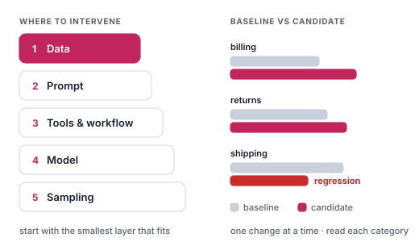

::: {.synthesis}
{fig-alt="Improvement experiments: an intervention hierarchy and a baseline versus candidate comparison by category"}
:::

::: {.in30}
- Pick one behaviour to change, from the pattern shared by observed failures, and decide what “good enough” means before testing.
- Compare baseline and updated versions fairly: same model, cases and evaluators, on failure cases and known-good cases.
- Read case-level tradeoffs and traces, and fix the lowest layer that fits the evidence: data, prompt, tools, model, then sampling.
:::

::: {.concepts}
::: {.concept}
`Target the behavior`

Before editing anything, decide exactly what failure pattern you want to change. Start from observed eval failures and evaluator notes, then infer the shared underlying issue.
:::
::: {.concept}
`Fair comparison`

To know whether a change helped, keep the model, test cases, evaluators, and other agent settings fixed. Run baseline and updated versions on the same dataset so the difference can be attributed to the change itself.
:::
::: {.concept}
`Tradeoff inspection`

Overall scores can hide regressions. Compare versions case by case, check categories separately, and inspect traces to see how the agent’s behavior changed.
:::
::: {.concept}
`Intervention hierarchy`

When an agent fails, start with the simplest layer that could explain it: data, then prompt, then tools/workflow, then model, then sampling settings. Choose the smallest change that plausibly fits the evidence.
:::
:::

## Pick the target

When you plan an improvement test, first decide **what behavior you want to change**. Do not start by changing the prompt right away. A change can fix one failure and create a new one. Or it can make several scores go up, but you will not know which change helped.

### Find the pattern behind the failures

Start with failures you already observed in evals. Read the failed examples and the evaluator explanations, then look for a shared problem.

::: {.column-margin .define label="Failure patterns"}
Individual bad examples are less useful than the common theme behind them. Group similar failures so you can design an intervention that addresses the real problem rather than one symptom.
:::

In the shelter agent example, several failures point to the same issue:

- one explanation says the volunteer’s **physical capacity was not assessed**
- another says **experience with large dogs was treated as sufficient**
- another says the dog’s **pulling strength was not considered**

These explanations sound different, but they all point to the same underlying problem: the agent should check **current physical handling ability**, not approve a match based on past large-dog experience alone.

### Capability evals and regression evals

Sometimes the target comes from a failure you already saw. Sometimes you already know a new ability you want the agent to gain.

- A **capability eval** checks for a new ability the agent should learn.
- A **regression eval** checks that a previous ability stays in place.

For example, you might want the shelter agent to remember: **“Don’t schedule me for walks after six.”** You can write an eval for that behavior before the agent can do it reliably. At first, you may expect it to fail. That still gives you a clear target to improve toward. This is sometimes called **eval-driven development**.

### Define what “good enough” means

A good target is specific enough that you can judge success later. Ask yourself:

- What exact behavior should change?
- What failure pattern should disappear?
- What result would count as good enough?

For the shelter agent, “good enough” means it should not approve a volunteer just because they have large-dog experience. It should check whether the volunteer can physically handle that **specific dog now**.

::: {.example}
**Shelter match goes wrong.** A volunteer has experience handling large dogs. The dog is a very large **Cane Corso** that pulls strongly on walks. The agent approves the match based on that experience alone. The target becomes checking the volunteer’s **current physical handling ability**, not just past large-dog experience.
:::

## Set up a fair comparison

A fair comparison helps you tell what really caused a change. If you update the prompt, but also change the test cases, the evaluator, or the model, you cannot know what produced the result.

For a prompt change, keep these fixed:

- the **model**
- the **test cases**
- the **evaluators**
- the rest of the agent configuration

Run the **baseline** agent and the **updated** agent on the **same dataset** with the **same evaluator definitions and results**. This way, the new prompt rule is the main difference between the two versions.

### Save two kinds of cases

You need both kinds of examples:

- **Failure cases**: the cases you want to improve
- **Known-good cases**: the cases that already work

Failure cases tell you whether the new change fixes the target problem. Known-good cases protect you against regressions, which are new mistakes in behavior that was already working.

::: {.compare}
::: {.col .bad}
**Only test failures**

You may improve the target problem, but you do not know whether the agent broke something else.

A prompt change can improve those failures and still damage behavior that was already working.
:::
::: {.col .good}
**Test failures and known-good cases**

You can check both: does the target behavior improve, and does old good behavior stay working?
:::
:::

For Northwind, the failure set includes the wool care question and other cases where the agent added product details that were not supported by the tool results. Save those traces from the faithfulness evaluator’s flagged failures—your “faithfulness failures” dataset. The known-good set can include basic sizing questions and straightforward product information requests.

### Decide the result you want before you look

Before you run the comparison, decide what “good enough” means for your application.

- A small improvement may be enough in one system.
- Another system may need a safety or policy rule to be almost perfectly reliable before you ship it.

Decide this **before** you inspect the new results. Otherwise, it is easy to keep changing the system just because more improvements are still possible.

::: {.example}
**Northwind’s grounding-rule test.** Northwind adds the rule, “Never state a product detail unless a tool result supports it.” Then it runs both versions on the same wool-care and sizing cases, using the same evaluators for both baseline and updated runs. In the wool-care example, before the change the product tool returned only “Machine washable on wool cycle,” and the agent added extra recommendations; after the change, the response stops after that instruction. The known-good sizing cases check whether the update caused new problems—for example, in a merino sweater sizing question, the updated agent calls the product tool again, but the lookup does not provide any new sizing information.
:::

## Read the tradeoffs

Do not stop at the overall score. A version can look better overall and still hide new problems. Compare the same cases side by side, then inspect the traces to see what changed in the agent’s path.

### Look at the categories separately

When you compare versions, ask three questions:

- What got better?
- What got worse?
- Which specific cases changed?

This matters because one improvement can hide one regression. For example, a stricter shelter agent may reduce unsafe matches, but it may also reject some volunteers who should qualify. If you only look at one total score, those effects can cancel each other out, so compare failure categories separately to see which ones changed.

### Read the trace, not just the final answer

A trace shows the steps the agent took. That lets you see whether a better answer came from a better process, or whether the process got worse even though the final answer stayed correct.

::: {.compare}
::: {.col .bad}
**Before**

The baseline Northwind agent gets a merino sweater sizing question. It already has the sizing information it needs, so it answers directly.

The final answer is correct, and the trace is short.
:::

::: {.col .good}
**After**

The updated agent still gives the same correct final answer, but it also calls the product tool again.

The extra lookup does not add new sizing information. The customer sees the same result, but the trajectory is worse.
:::
:::

### Check whether the gain is worth the cost

A grounding rule can help a lot. In Northwind, it improves the wool-care answer. Before the change, the product tool returned one instruction: “Machine washable on wool cycle.” But the baseline agent added several more recommendations. After the change, the agent now says the sweater can be machine washed on the wool cycle, and it stops there. The unsupported extra recommendations are gone.

But the same rule can also cause extra tool calls in cases that were already working. That can matter if:

- tool calls are expensive,
- latency matters for the application,
- or a few rare failures still remain.

If unsupported product claims could seriously mislead a customer, the extra lookup may be worth it. If the application needs to stay fast and cheap, you may want a more precise rule.

::: {.example}
**Northwind: correct answer, worse trace.** The updated Northwind agent now gives the correct wool-care answer: “Machine washable on wool cycle.” But on a merino sizing question, it also makes an unnecessary extra product lookup, even though it already had the sizing information.
:::

### Decide from the comparison

Do not guess. Run the baseline and the updated version on the same cases with the same evaluators, and keep the traces with them. Then inspect the traces where the behavior diverged. That tells you whether the change is really worth keeping, and what to try next.

Maybe the next version should make it clearer that the agent can use supporting information it already has and only needs another lookup when that information is missing. That would be another candidate change. You would test it the same way. Keep the cases and evaluators fixed, run the new version, and see whether the care behavior stays improved while the unnecessary lookups go away.

And again, don't assume the new wording will work just because the explanation sounds plausible. Run the comparison, and let the results tell you.

There's also a bigger question here: How long should you keep iterating? You can almost always find one more thing to improve, but each additional change takes engineering time, and that time has to be worth what you expect to gain from it. Maybe the first iteration removes a large cluster of failures, then the next one fixes a smaller group. Eventually, what remains may be a handful of rare cases that each require a lot of specialized work. That doesn't mean those cases never matter. A rare safety failure can be much more important than a common cosmetic one.

So look at the value of the improvement, the severity of the remaining failures, and the effort required for the next change, and go back to the bar you set before you started. Did the new version reach the level of performance you said you needed? Are the remaining regressions acceptable for this application? If so, you may decide that this version is good enough for now, or you may decide that the extra lookup is important enough to justify another round. Those are two different decisions. You can keep the improvement you already made and still decide to stop iterating, or you can keep the change and move on to something more valuable.

## Choose where to intervene

When an agent fails, match the fix to the evidence. Start with the simplest layer that could explain the problem, then move up only if needed. This is an intervention hierarchy, such as this one by Hamel Husain:

1. data
2. prompt
3. tools and workflow
4. model
5. sampling settings, like temperature

This is not a rigid recipe. The idea is to choose the smallest change that can reasonably explain the failure.

### Start with the data

If the information is missing or inconsistent, fix the data first.

For example, a dog record says that Atlas pulls hard on walks, but the structured field for “needs an experienced handler” is blank. If the agent matches Atlas with a first-time volunteer, the problem is probably not the prompt. The better fix is to change the data-entry or processing rule so that strong pulling fills the experienced-handler field correctly.

::: {.example}
**Blank experienced-handler field.** Atlas has pulling notes in the record, but the structured field for experienced handler is empty. The agent matches Atlas with a first-time volunteer. The better fix is to populate that field from the notes, not to ask the prompt to compensate for missing data. Changing the prompt would be less direct.
:::

If the failure disappears after you fix the record and run the same eval again, you improved the information the agent receives.

### Move to the prompt

If the data is complete, but the requirement is unclear, check the prompt.

For example, if the agent schedules an outing without checking whether the volunteer is eligible, add a clear rule like: “Always check eligibility before scheduling an outing.”

If that is still not enough, examples can help. You could show:
- one case where the volunteer is eligible and the outing proceeds
- one case where the volunteer is not eligible and scheduling stops

Be careful with examples. If every example uses a large dog, the agent may learn a narrower pattern than you intended. Test the revised prompt on different cases, like a small dog or a dog with a medical restriction. Also phrase the example requests in different ways. If the behavior only works on cases that closely resemble the examples, the prompt may be too narrow.

### Check tools and workflow

If the prompt is clear and the agent is trying to follow it, ask whether the tools and workflow make the right action easy.

::: {.column-margin .watch}
A new tool call can add latency and API cost. It can also create another failure point. For a safety-related eligibility check, that trade-off may be worth it. For an optional step, it may not.
:::

For example, if the agent calls an eligibility lookup and the tool returns **“no match”**, the tool contract should say what happens next:
- if eligible, continue
- if not eligible, stop
- if no match, ask for information needed to identify the volunteer

If the instructions are still not reliable enough, make the step part of the workflow itself. Put the eligibility lookup directly before scheduling, so the flow is:
1. receive the request
2. check eligibility
3. continue to scheduling

::: {.steps}
1. **Receive the request**: the agent gets the user’s request.
2. **Check eligibility**: the lookup happens before any scheduling.
3. **Continue to scheduling**: only eligible cases move forward.
:::

A stronger workflow can make an important requirement more reliable. But every extra step has a cost: more latency, more API cost, and one more place where something can go wrong.

### Consider the model

If the data is good, the instructions are clear, and the tools and workflow are correct, but the task is still too hard, then consider the model itself.

A model swap is a broad intervention. It can change behavior across many requests, and it can also change latency and cost. Run the same evaluation suite, check the failures you wanted to improve, check the cases that were already working, and compare the costs too.

### Sampling settings are last

At the top of the hierarchy are settings like **temperature** and other sampling parameters. Modern models sometimes do not let you change them. When they are available, they affect how variable the outputs are.

But they are usually not the right place to start if the real problem is:
- missing information
- an unclear rule
- the wrong tool
- an unreliable workflow

Changing temperature does not create missing data, add a rule to the prompt, or define what “no match” means. These settings are more useful when variability itself is the problem.

So when you find a failure, match the change to the evidence:
- missing or inconsistent information → data
- information is present, but the requirement is unclear → prompt
- the agent knows what to do, but struggles to do it reliably → tools and workflow
- the earlier layers work, but the task is still too hard → model
- the problem is really about output variability → sampling settings

Whatever layer you change, use the same discipline: make a change you have reason to believe could help, run the same evaluation again, and check both the behavior you wanted to improve and what else changed.

::: {.callout-tip}
## Remember
- Don’t change the prompt before you know what behavior you’re trying to fix.
- Keep the comparison fair: same model, same cases, same evaluators.
- A higher score can still hide new failures.
- Look at case-level changes, not just averages.
- Fix the lowest-level cause that matches the evidence.
:::

You change the prompt and the model in the same experiment. What is the problem?

You cannot tell which change produced the result. Keep the model, cases, evaluators and the rest of the configuration fixed, and change one thing.

Why keep known-good cases next to the failure cases?

To catch regressions: a change can fix the target failures and still break behaviour that was already working.

Atlas pulls hard, but the experienced-handler field is blank. Which layer do you fix?

The data: fill the field from the notes (the data-entry or processing rule), rather than asking the prompt to compensate.

## Sources {.sources}

- [Lesson: Planning an improvement test](https://learn.deeplearning.ai/courses/evaluating-and-improving-agentic-applications/lesson/k2csh8/planning-an-improvement-test)
- [Lesson: Comparing versions and assessing tradeoffs](https://learn.deeplearning.ai/courses/evaluating-and-improving-agentic-applications/lesson/de1cnr/comparing-versions-and-assessing-tradeoffs)
- [Lesson: Choosing where to intervene](https://learn.deeplearning.ai/courses/evaluating-and-improving-agentic-applications/lesson/2fnhlq/choosing-where-to-intervene)
