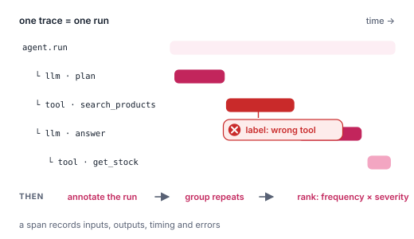

::: {.synthesis}
{fig-alt="A trace as a tree of spans on a timeline, with one span labelled as a failure"}
:::

::: {.in30}
- A **trace** records one agent run as a tree of **spans**: model calls, tool calls, their inputs, outputs and timing.
- Your app must be **instrumented** so the right work is captured; Phoenix then lets you open a run and inspect each span.
- Use the trace as evidence to label a run pass or fail; if you still cannot tell, mark it unresolved.
:::

::: {.concepts}
::: {.concept}
`Trace vs. run`

A run is one full execution of the agent, and a trace is the record of that run. The trace lets you inspect the steps between input and output, not just the final answer.
:::
::: {.concept}
`Span tree`

A span is one recorded operation inside a trace. Spans are organized as a tree with a root span for the whole request and child spans for smaller actions like tool calls or model calls.
:::
::: {.concept}
`Instrumentation`

Instrumentation is the code that records operations as they happen. Without it, the trace will not contain the evidence needed to inspect or evaluate the run properly.
:::
::: {.concept}
`Traces as evaluation evidence`

Use the trace to compare the agent’s actual behavior with the requirement and expected result. If the evidence is insufficient, do not guess; either gather more information or mark the case unresolved.
:::
:::

## What a trace shows

A **trace** is the record of one agent run. A **run** is one full execution of the agent, from the request to the final response.

A trace helps you see what the agent did between input and output. That matters because the answer alone does not show whether the agent used tools, checked data, or skipped a step. For example, an agent might skip an inventory check and still make up that a jacket is in stock. Without a trace, you would not know whether the agent actually checked inventory.

### Spans and nesting

Each recorded operation in the run is a **span**. A span has a beginning and an end.

Spans can nest inside each other. That gives you a tree of spans:

- the **root span** covers the whole request
- **child spans** show operations inside that request
- child spans can have their own children

This tree is built from the operations your application records. It is not a fixed plan for the agent. Another run may have different tool calls or repeated steps, and those tool calls may be repeated or different in a later run.

```{mermaid}
flowchart TD
  R["Root span: Northwind refund request"]
  O["Child span: Order lookup tool call"]
  F["Child span: Refund tool call"]

  R --> O
  R --> F
```

::: {.example}
**Northwind refund trace.** A customer asks Northwind for a refund. The trace starts with a root span for the whole refund request. Under it, there is an order lookup span that checks the order details, then a refund span that processes the refund. If the refund amount is wrong, the trace lets you check whether the agent looked up the right order and what purchase price the tool returned.
:::

## What each span records

### What a span can tell you

A span can record:

- the **name** of the operation
- the **type** of span, such as **tool call** or **model call**
- the **input** sent to the operation
- the **output** returned by the operation
- **token usage** for model calls, which is how much text the model took in and generated
- the **model version**
- the **prompt** used
- the **start and end time** of the operation, so you can see how long it took

These details can be recorded as **attributes** on the span.

### How to read tool-call spans

A tool-call span shows what the application sent to a tool and what came back.

For example, the span for looking up a customer's order can show:

- the order ID sent to the tool
- the order details returned
- the purchase price returned

This helps you check problems like a refund for the wrong amount. You can see whether the agent looked up the right order and what price the tool returned.

::: {.example}
**Looking up an order.** An agent sends order ID `A-1842` to an order lookup tool. The tool returns the order details and the purchase price. If the agent later refunds the wrong amount, you can inspect this span to check whether the right order was used.
:::

### How to read model-call spans

A model-call span gives a different view. Its input can include:

- the customer's message
- the agent's instructions
- information returned by earlier tools

Its output records what the model generated. That can be:

- an answer for the customer
- a request to use a tool

Model-call spans can also include:

- token usage
- model version
- prompt

These details help you compare runs and understand what changed. These spans are based on the operations your application records.

### Timing and limits

Spans record when each operation started and ended. That lets you see where time was spent. If the customer waited too long, you can check whether the delay came from the model call or the order lookup.

```{mermaid}
flowchart TD
    A[Open run] --> B[Select a span]
    B --> C[Read name and type]
    B --> D[Inspect input and output]
    B --> E[Check token usage, model version, and prompt]
    B --> F[Check start and end time]
```

Spans can also reveal repeated tool calls that add unnecessary work, even if the final answer is correct.

But tracing has limits. A trace does **not** show everything happening inside the model. Any reasoning text you see is still generated output, not a direct view into the model's internal process.

### Annotated span detail panel

| Field | What it shows |
|---|---|
| Name | Which operation ran |
| Type | Tool call or model call |
| Input | What was sent to the tool or model |
| Output | What came back |
| Token usage | How much text the model took in and generated |
| Model version | Which model ran |
| Prompt | The prompt used |
| Start / end time | When the operation began and ended |

::: {.steps}
1. **Open the run**: choose the run you want to inspect.
2. **Select a span**: click a tool-call or model-call span in the tree.
3. **Read the details**: inspect the input, output, timing, token usage, model version, and prompt.
4. **Check the limits**: confirm the span was actually recorded before drawing conclusions.
:::

## Inspect and instrument runs

A trace is only useful if your app records the right work. That recording is called **instrumentation**. It means adding code that captures operations as they happen.

### How traces are collected

The tracing integration sends recorded spans to **Phoenix**, which is the tool you will use in this course to collect and inspect traces.

::: {.column-margin .define label="Phoenix"}
The tracing integration sends spans to Phoenix, where you can open a run, follow the tree, and select spans for closer inspection. Phoenix is the main interface used in the course to review traces.
:::

```{mermaid}
flowchart LR
    A[Your app] --> B[Instrumentation]
    B --> C[Tracing integration]
    C --> D[Phoenix]
    D --> E[Open a run]
    E --> F[Follow the tree]
    F --> G[Select a span]
    G --> H[Inspect inputs, outputs, timing, and other details]
```

Instrumentation can happen in different ways:

- It can automatically capture **model calls** and **tool calls**.
- It can record their **inputs**, **outputs**, and **timing**.
- You can also add recording around your own functions if the integration does not cover them.

### Inspect a run in Phoenix

In Phoenix, you can:

1. Open a **run**.
2. Follow the **tree** of spans.
3. Select one span to inspect its recorded details.

This lets you see what happened step by step.

::: {.example}
**Open a run and inspect one span.** A user asks something that triggers a model call and a tool call. In Phoenix, you open the run, follow the tree, and click one span to check its inputs, outputs, and timing.
:::

### Watch for missing instrumentation

A trace only contains what your setup recorded. If an **order lookup** was not instrumented, you might still see the model calls, but miss the lookup between them.

That means:

- a missing span does **not** always mean the agent skipped an action;
- before you conclude that something did not happen, check that the relevant work was being captured.

::: {.callout-warning}
## Watch out

Do not assume a missing span means the agent did nothing. First check that the relevant operation was instrumented and sent to the tracing tool.
:::

## Use traces to label failures

Use the trace as evidence before you decide a run passed or failed. The trace shows what the agent actually received and did, so you can compare that with the requirement and your expected result.

If the case is still unclear, do not guess. Check the relevant facts or ask for help interpreting the requirement. If you still cannot tell whether the application met the requirement, mark the case as **unresolved** and write down what evidence or decision is missing.

### Record the judgment with the run

For each run, write down:

- whether it **passed** or **failed**
- why you made that judgment
- the trace you reviewed
- any explanation that is still only a possibility

Keep that judgment with the result and trace. Another run of the same case could turn out differently.

::: {.example}
**Unsafe dog match.** A volunteer wanted to walk a 130-lb dog, but the dog was too strong for them to control safely. The agent approved the match, so the run failed. The trace helps you check whether the agent had the volunteer’s limits and still made the wrong choice, or whether it never received that information.
:::

### Group repeated problems

After you review individual runs, group the ones that show the same problem. This helps you see which mistakes keep happening and how many cases each problem affects.

Use the trace to decide whether two failures belong together:

- group them if the agent had the right information but made the same wrong decision
- keep them separate if the agent had a different problem, like retrieving the wrong record

Give each group a clear name and a short explanation of what it means, with an example. Use the name consistently as you review more cases.

Across this course, five broad labels help name these problems:

- **Judgment**: the agent had the relevant information but made the wrong decision
- **Groundedness**: problems with the evidence the agent retrieves or the claims it makes
- **Execution**: mistakes in carrying out required actions
- **Completion**: the intended result did not actually happen
- **Propagation**: a mistake or missing instruction carried into later steps

A run can have more than one label. If one label is the main one, keep the others too. If you later clarify what a label means, or split one group into two, update earlier labels so they match.

### Rank by frequency and severity

After you label the failures, use the groups to decide what to fix first. Count how often each problem showed up across all the runs you checked for it, including the ones that passed. Do not count only failures, or the problem may look more or less common than it is.

Then rank problems by how serious the harm could be. A rare mistake can matter more than a common one if the risk is high.

| Failure label | What it means | Severity example | Frequency note |
|---|---|---|---|
| Judgment / reasoning error | The agent had the needed information but made the wrong decision | Unsafe dog match could cause injury | May appear only once, but still come first |
| Groundedness | Wrong evidence or unsupported claim | Wrong dog record or unsupported claim about an evaluation | Count all reviewed runs, not only failures |
| Execution | The agent skipped a required action | Missing eligibility check | Use all runs checked for this problem |
| Completion | The intended result did not happen | Agent says an outing is scheduled, but no calendar entry exists | Include passing runs in the count |
| Propagation | A mistake carried into later steps | Wrong record used, then confirmed later | Track how the error spreads |

You may still prioritize a low-frequency problem first if it could cause serious harm. For example, an unsafe match can matter more than awkward formatting, even if awkward formatting appears more often.

### Add annotations to the run

Once you have evaluated a run, record your assessment alongside the trace. In Phoenix, this is called an **annotation**. An annotation can include a label or a score, plus an explanation.

Use annotations to keep your judgment attached to the evidence you reviewed, and to make later review easier. Also remember that one customer conversation can include several runs. Each run has its own trace, and a shared **session ID** groups those traces so you can follow the whole conversation.

After you record the assessment, you can then practice the process in a lab and graded assignment, and later use it to improve or diagnose an agent as part of your workflow.

::: {.callout-tip}
## Remember
- A trace shows what the agent did, not just what it answered.
- Spans are the recorded steps inside a trace; their tree reflects recorded operations, not a fixed plan.
- Instrument your app so the important work is captured.
- Use the trace as evidence before deciding pass or fail.
- If you cannot tell, mark the case unresolved.
:::

<details class="quiz">
<summary>The trace shows no inventory lookup span. Did the agent skip the inventory check?</summary>

Not necessarily. First check that the lookup was instrumented: a trace only contains what your setup recorded.

</details>

<details class="quiz">
<summary>A customer waited too long. Where in the trace do you look?</summary>

At the start and end times of the spans, to see whether the delay came from the model call or from a tool such as the order lookup.

</details>

<details class="quiz">
<summary>Why count passing runs when ranking failure groups by frequency?</summary>

Frequency is measured over all the runs checked for that problem; counting only failures makes it look more or less common than it is.

</details>

## Sources {.sources}

- [Lesson: Traces](https://learn.deeplearning.ai/courses/evaluating-and-improving-agentic-applications/lesson/gy3a4e/traces)
- [Lesson: Analyze and label failures](https://learn.deeplearning.ai/courses/evaluating-and-improving-agentic-applications/lesson/9i8rmo/analyze-and-label-failures)
