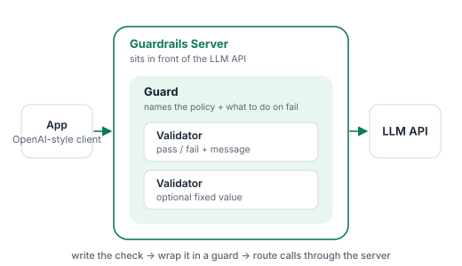

::: {.synthesis}
{fig-alt="Custom guardrails: validators inside a guard, inside a Guardrails Server between the app and the LLM API"}
:::

::: {.in30}
- A **validator** checks an input or output and returns pass or fail, an error message, and optionally a fixed value.
- A **guard** wraps one or more validators: it names them, says whether they run on input or output, and what to do on failure.
- **Guardrails Server** enforces the guard in front of the LLM API; the app keeps an OpenAI-style client pointed at it.
:::

::: {.concepts}
::: {.concept}
`Validator`

The core rule-checking unit. It inspects text and returns a structured result: pass or fail, an error message on failure, and optionally a fixed_value to replace the original text.
:::
::: {.concept}
`Guard`

A wrapper that bundles one or more guardrails, gives them a name, and defines when they run and what action to take if they fail.
:::
::: {.concept}
`On-fail action`

The behavior attached to a guard when validation fails. Common options include raising an exception or attempting to fix the output.
:::
::: {.concept}
`Guardrails Server`

The enforcement layer that sits between the app and the model API. It intercepts LLM requests, applies the guardrail logic, and stays OpenAI-compatible so existing clients can be pointed at it with minimal changes.
:::
:::

## What a validator checks

A **validator** is the core rule-checking logic. It looks at an input or output and decides if it follows the rule you want.

::: {.column-margin .define label="Validation rule"}
A validator encodes the exact behavior you want, such as blocking a forbidden topic by failing whenever a specific substring appears in the text.
:::

A validator returns a result with:
- **result**: **pass** or **fail**
- **error_message** when it fails
- **fixed_value** as an **optional** replacement value if you want to replace the text

::: {.example}
**Blocking a forbidden topic.** A validator checks the text and fails when it **mentions** **Project Colosseum** — in other words, when the text contains that substring. In that case, it returns: **“I’m sorry I can’t answer questions about Project Colosseum.”**
:::

```{mermaid}
flowchart TD
    A[Text to check] --> B{Rule matches?}
    B -->|Yes| C[Pass]
    B -->|No| D[Fail]
    D --> E[Error message]
    D --> F[Optional fixed value]
```

Here is the shape of the logic in a validator class:

```python
class ProjectColosseumValidator:
    def validate(self, text):
        if "Project Colosseum" in text:
            return {
                "result": "fail",
                "error_message": "I’m sorry I can’t answer questions about Project Colosseum.",
                "fixed_value": "I’m sorry I can’t answer questions about Project Colosseum."
            }

        return {
            "result": "pass"
        }
```

## Wrap it in a guard

A **guard** is the wrapper around one or more guardrails. It gives the guardrails a name and tells the system when to run them and what to do if they fail.

::: {.column-margin .watch}
The guard does not replace the validator. The validator does the check. The guard controls the name, the input or output setting, and the on-fail action such as **exception** or **fix**.
:::

### How a guard is configured

A guard can include:
- **One or more guardrails**: the checks you want to apply.
- **A name**: for example, **"Colosseum Guard"**.
- **An on-fail action**: what happens when a validator fails. Common actions include:
  - **exception**: stop and raise an error.
  - **fix**: try to correct the output.
- **Where it runs**:
  - **on input**: check what the user sends in.
  - **on output**: check what the model returns.

```{mermaid}
flowchart LR
    A[Input] --> B[Guard]
    B --> C[Validator]
    C --> D[Action]
```

::: {.example}
**Colosseum Guard raises an exception.** A guard named **"Colosseum Guard"** wraps a validator. When the validator detects **Colosseum**, the guard is set to **raise an exception** instead of letting the result pass.
:::

## Run through Guardrails Server

Guardrails Server wraps the LLM API call. Your app does not call the model directly. Instead, it sends the request to the server, and the server applies the guardrail before or during the model call.

::: {.column-margin .watch}
OpenAI-compatible does not mean you are calling OpenAI itself. It means the client speaks the same API style, but the request goes to the Guardrails Server endpoint you configure.
:::

This works because Guardrails Server is OpenAI-compatible. That means you can use an OpenAI-style client, but point it at the local Guardrails Server instead of the normal OpenAI endpoint. In practice, the chatbot can swap the usual client for a guarded client, while keeping the same kind of API call.

```{mermaid}
flowchart LR
    A[Chatbot app] --> B[Guarded client]
    B --> C[Guardrails Server]
    C --> D[LLM API call]
```

::: {.example}
**Swap the client for a guarded one.** A chatbot that normally uses the OpenAI client can replace it with a guarded client that points to the local Guardrails Server. The app keeps making an OpenAI-style request, but the server now enforces the guardrail around the LLM call.
:::

### How the swap works

::: {.steps}
1. **Keep the app logic the same**: the chatbot still sends a normal model request.
2. **Replace the client**: use a guarded client instead of the plain OpenAI client.
3. **Point it to the local server**: the client sends requests to the Guardrails Server.
4. **Let the server handle the guardrail**: the server wraps the LLM API call and enforces the validator through the guard.
:::

::: {.callout-tip}
## Remember
- Write the validator first: it defines the actual check.
- A validator should return pass/fail, plus an error message and optional replacement.
- Use a guard to package validators and choose the failure behavior.
- Guardrails Server enforces the rules by wrapping the LLM call.
- You can keep an OpenAI-style client and point it to Guardrails Server instead.
:::

## Sources {.sources}

- [Lesson: Building your first guardrail](https://learn.deeplearning.ai/courses/safe-and-reliable-ai-via-guardrails/lesson/ph1aa/building-your-first-guardrail)
