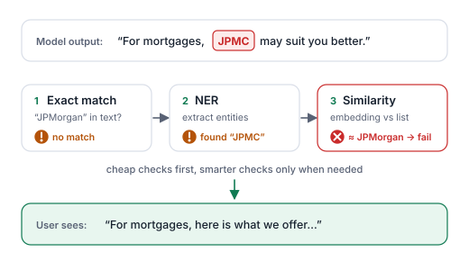

::: {.synthesis}
{fig-alt="Competitor-mention guardrail: exact match, then NER, then embedding similarity catch JPMC as JPMorgan"}
:::

::: {.in30}
- In a branded, customer-facing chatbot, naming a competitor is a failure; listing every name variant up front is not realistic.
- A cascading validator checks exact names first, then extracts entities with NER, then compares them to competitors by embedding similarity.
- Served through a guardrail server and a guarded OpenAI client, it fails a reply that mentions a competitor before it reaches the user.
:::

::: {.concepts}
::: {.concept}
`Brand-safety guardrail`

In customer-facing chatbots, even mentioning a competitor by name can be unacceptable. The goal is to keep responses on-brand and avoid disallowed entities altogether.
:::
::: {.concept}
`Cascading detection pipeline`

The validator uses a step-by-step cascade to catch competitor mentions efficiently: exact string matching first, then NER-based entity extraction, then embedding similarity as a fallback.
:::
::: {.concept}
`Exact match check`

The fastest and most reliable first pass is to compare the output directly against a known list of competitor names. If a match is found, the response fails immediately.
:::
::: {.concept}
`NER plus similarity`

If no exact match exists, named entity recognition identifies candidate entities in the text, and vector similarity compares them to known competitor names to catch variations or paraphrases.
:::
:::

## Why block competitor names

In a customer-facing chatbot, mentioning a competitor by name can be a failure mode. For branded applications, this is often not acceptable. The bot should stay on-brand and avoid naming other companies in its reply.

This section specifically recreates an earlier failure mode using the Alfredo’s Pizza chatbot example from the course: it sets up an unguarded chatbot, then tries a large pizza order to compare how the bot behaves when the competitor “Pizza by Alfredo” is mentioned. The guardrail is built to prevent the chatbot from mentioning that main competitor by name.

A simple word match is not enough. You might think that checking for one exact name would solve the problem, but companies can have multiple names or variations, so it can be hard to list every possible form. For example, a competitor might be referred to in more than one way, like GMC vs JPMorgan in other contexts. Because enumerating all common names is difficult, this page uses a cascading approach to detect competitor mentions.

::: {.example}
**Alfredo’s Pizza and Pizza by Alfredo.** A customer asks why they should order from Alfredo’s Pizza Cafe instead of Pizza by Alfredo. The unsafe chatbot reply names “Pizza by Alfredo” directly. In the safe version, the bot avoids mentioning the competitor by name.
:::

::: {.compare}
::: {.col .bad}
**Unsafe response**

The chatbot mentions the competitor by name in a customer-facing reply, such as “Pizza by Alfredo.”
:::
::: {.col .good}
**Safe response**

The chatbot does not mention the competitor by name. It gives a branded answer without naming other companies.
:::
:::

And if you want, you can ignore the specific validation error message and instead provide a more graceful user-facing message by catching the raised exception.

## Cascading detection

The validator uses a cascade, or step-by-step pipeline. It checks the easiest cases first.

::: {.column-margin .watch}
A shorthand may not match by exact string. That is why the pipeline continues to NER and then similarity scoring.
:::

```{mermaid}
flowchart TD
    A[Text output] --> B[Exact string match]
    B -->|exact match found| F[Fail]
    B -->|no exact match| C[Named entity recognition]
    C --> D[Extract entities]
    D --> E[Embedding similarity vs known competitors]
    E -->|similarity > threshold| F
    E -->|similarity <= threshold| G[Pass]
```

### How the pipeline works

1. **Exact string match first**: the validator checks whether the text contains an exact match to any one of the known competitor names. If it finds one, it immediately fails the validator.
2. **Named entity recognition (NER) next**: if there is no exact match, the validator extracts named entities mentioned in the text. NER means a model finds names such as people, places, and organizations.
3. **Embedding similarity last**: the validator compares the embeddings, or vector representations, of the extracted entities with the embeddings of known competitor names.
4. **Threshold decides the result**: if similarity is greater than the chosen threshold, the validator fails. If not, it passes.

### Example

::: {.example}
**“JPMC” after exact matching fails.** The text does not contain the full competitor name “JPMorgan”, so exact matching does not trigger. NER extracts “JPMC”, and the extracted entity is then compared by embedding similarity against known competitors. Since “JPMC” has a very close embedding to “JPMorgan”, and the similarity is above the threshold, the validator fails.
:::

## Build the validator

The cascade above, as a custom validator.

### Validator structure

The custom `CompetitorCheckMentionsValidator` has these parts:

- an `__init__` method
- a list of competitor names, stored as a class variable
- an exact match function
- an entity extraction function
- an embedding model
- precomputed embeddings for competitor names
- a `validate` function that ties everything together

It lowercases the competitor names for easier matching.

It also imports standard machine learning tools such as Transformers, Sentence Transformers, sklearn metrics, and numpy.

::: {.steps}
1. **Initialize the validator**: take the competitor list in `__init__`, store it as a class variable, and lower it.
2. **Check exact matches first**: scan the text for any competitor name using regex.
3. **Extract named entities**: run the text through the NER pipeline.
4. **Prepare similarity search**: load the embedding model and store precomputed embeddings for the known competitors.
5. **Compare entities to competitors**: compute similarity and collect matches above the threshold.
6. **Return the result**: fail if any competitor is found, otherwise pass.
:::

### Exact match, then NER, then similarity

The exact match stage is simple regex-based checking. It iterates over the list of competitors and looks for an exact match to competitor names in the text. If one of the known competitor names is present in the text, the validator immediately fails. The exact match function also returns which competitors were detected in the text.

If there is no exact match, the validator uses a NER pipeline built with a simple BERT base tokenizer and model. The NER model is initialized as a class variable, and the NER output is read entity by entity from the pipeline. Tokens that start with `B-` or `I-` are added to the extracted entity list. The cleanup step removes surrounding spaces and other extra characters.

After that, the validator uses vector embeddings. It compares the vector embeddings of the extracted named entities with the embeddings of the known competitors. If the similarity is greater than the threshold, it adds the detected items to a list of matches and fails again, depending on whatever competitors are detected.

::: {.example}
**Lowercased competitor names and a fail result.** A `CompetitorCheckMentionsValidator` stores competitor names in lowercase. It checks text for exact matches first. If it finds a competitor name, it returns a fail result right away.
:::

```{mermaid}
flowchart TD
    A[Initialize validator] --> B[Store competitor names in lowercase]
    B --> C[Exact match check]
    C -->|Match found| D[Fail result]
    C -->|No match| E[NER entity extraction]
    E --> F[Precompute competitor embeddings]
    F --> G[Compare entity embeddings with competitors]
    G -->|Similarity above threshold| D
    G -->|No match| H[Pass result]
```

The validator logic should match the earlier detection step: it calls the vector similarity match function with the extracted entities. That match logic iterates over the entities, computes similarity with any of our known competitors, and adds a match only when the similarity is greater than a threshold. If any competitors are detected, it returns a fail result with the list of detected entities. If no entities are detected, it returns a pass result.

### What the validator returns

The validator uses the same pattern in both stages:

- if any competitor is detected, it raises a fail result with the list of entities that were detected
- if no competitor is detected, only then does it return a pass result

## Run it in a guarded client

Use Guardrails Hub to download the competitor-check validator. Then run it through a guardrail server. After that, swap your normal OpenAI client for a guarded OpenAI client. The guarded client uses a base URL that points to the guardrail server.

::: {.column-margin .define label="Guarded client"}
The validator is run through a guardrail server and exposed through a guarded OpenAI client. This inserts validation between the app and the model so unsafe outputs are intercepted before delivery.
:::

This changes the flow:

```{mermaid}
flowchart LR
  A[App] --> B[Guardrail server]
  B --> C[Validator]
  C --> D[Model response]
  D --> B
  B --> A
```

When the same prompt is sent through this guarded client, the validator checks the output before the response returns to the app. If it detects a competitor name, it raises a fail result. If no competitor is found, it passes the response.

::: {.example}
**Guarded client blocks a competitor mention.** A RAG chatbot is changed to use the guarded OpenAI client instead of the vanilla OpenAI client. The app sends the same prompt again, and validation fails because “Pizza by Alfredo” is detected in the output.
:::

### What happens in the guarded setup

::: {.steps}
1. **Download the validator from Guardrails Hub**: use a version of the comparator check validator from Guardrails Hub, which is a state of the art version of this validator.
2. **Run it on the guardrail server**: the server exposes the guard endpoint with that validator.
3. **Swap the client**: replace the vanilla OpenAI client with the guarded OpenAI client.
4. **Send the same prompt**: the response is checked before it is returned.
5. **Handle failure if needed**: you can catch the exception and show a more graceful message, such as telling the user you will not respond to the request.
:::

::: {.callout-tip}
## Remember
- Start with exact matches; they are the cheapest and most precise filter.
- Use NER and embeddings to catch renamed, paraphrased, or slightly altered competitor mentions.
- A validator should fail the output before it reaches the user, not after.
- Guardrails can be inserted transparently by pointing the client to a guardrail server.
- This pattern applies to competitor names and any other disallowed entities.
:::

## Sources {.sources}

- [Lesson: Preventing competitor mentions](https://learn.deeplearning.ai/courses/safe-and-reliable-ai-via-guardrails/lesson/bc597/preventing-competitor-mentions)
