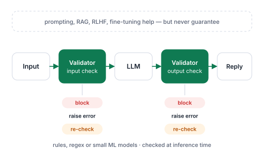

::: {.synthesis}
{fig-alt="Guardrails: validators check the input before the LLM and the output after it, and can block, fix or re-ask"}
:::

::: {.in30}
- Guardrails are runtime **validators**: they check the prompt, the response or both against explicit rules, then block, raise or re-check.
- Prompting, RAG, RLHF and fine-tuning help but never make a model fully predictable, which production apps in regulated domains need.
- Validators range from regex and rules to small ML models and LLM judges, matched to the risk: PII, off-topic use, hallucinations, competitors.
:::

::: {.concepts}
::: {.concept}
`Guardrails as validators`

Guardrails are secondary checks, not a replacement for the model. They inspect inputs or outputs at runtime and enforce rules by blocking, raising errors, or triggering rechecking.
:::
::: {.concept}
`Why prompting falls short`

Good prompts, RAG, RLHF, and fine-tuning help, but they do not remove all unpredictability. Production apps need more than “best effort” behavior when correctness and compliance matter.
:::
::: {.concept}
`What to validate`

Guardrails can inspect the input, the output, or both. Common targets include hallucinations, policy violations, unsafe content, and format constraints.
:::
::: {.concept}
`Validator implementations`

Validators can be built with rules engines, regex, or smaller ML models such as Transformers. The choice depends on the kind of rule and the depth of checking needed.
:::
:::

## What guardrails are

Guardrails are **secondary checks** in an LLM app. They do not replace the model. They check the **input** or the **output** against clear rules at runtime, so the app does not trust the model blindly.

::: {.column-margin .watch}
Guardrails do not remove all variability from LLMs. They add checks that improve safety and reliability, but they are not a full replacement for good prompting, fine-tuning, RLHF, or RAG.
:::

A guardrail acts like a **validator**. A validator is a function that takes a user prompt, an LLM response, or both, then checks whether it matches a predefined rule. If it does not, the app can block it, raise an exception, or send it back for more checking.

Guardrails are built into AI applications as a **protective framework**: they add a layer of control and oversight that helps align runtime behavior with developer expectations. They support building safe and responsible AI.

Guardrails help prevent unintended, incorrect, irrelevant, or sensitive content from reaching the user, and help applications move from proof of concept to production.

### Simple and complex checks

Some validators are **simple**. They can use a regex expression, which is a text pattern match. For example, a validator can look for phone numbers or email addresses and block the prompt before it is sent.

Other validators are **more complex**. They may check meaning, policy, formatting, or domain rules. In practice, a guardrails system often uses both kinds: simple checks for obvious patterns and stronger checks for harder cases.

::: {.example}
**Blocking private contact details.** A user types a message that contains a phone number or an email address. A regex-based validator checks the input, and if it finds personal information, the app throws an exception to prevent the information from being revealed to the user.
:::

## Why prompting is not enough

Prompting helps, but it does not make an LLM fully predictable. Even with good system instructions, RAG (retrieval-augmented generation, which adds retrieved documents as context), RLHF (reinforcement learning from human feedback), and fine-tuning, the model can still vary in what it says. These techniques help significantly, but they still can’t fully eliminate output variability and unpredictability.

That is a problem in production. A proof of concept can look good, but real products need reliability and compliance. Teams in healthcare, government, and finance often need strict consistency. On their own, LLMs are usually not trustworthy enough for that. This is why guardrails readiness matters when moving from proof of concept to production: reliability is often the key blocker to industry compliance and consistent behavior.

### POC works vs production risks

| POC works | Production risks |
|---|---|
| A simple chatbot seems to answer questions well after prompt engineering and RAG. | The same bot can still hallucinate and give answers that are not in the source data. |
| The system prompt says what the bot should and should not do. | The model can still ignore the intended scope and answer out-of-domain questions. |
| The demo feels useful for a first version. | Real systems need guardrails to catch incorrect, irrelevant, or sensitive output at runtime. |

::: {.example}
**Alfredo’s Pizza Cafe still hallucinates.** A RAG chatbot for Alfredo’s Pizza Cafe uses a shared document set with menu items, directions, payment methods, offers, and company info. In the notebook, there is a working POC where the bot can respond to a simple “Hi, how’s it going?” message. But when the user asks for a detailed recipe for the “Veggie Supreme” pizza, the bot still gives ingredients and cooking steps like preheating the pizza oven and rolling out dough, even though the recipe is not in the shared data drive. This shows that even with system prompts and retrieval, hallucinations can still happen.
:::

The same thing can happen with unintended use. The bot can be pushed to answer unrelated topics, even with a system instruction like: “Answer the customer’s question about world or politics… Weave in the pizza offerings…” When the actual question is, “What’s the difference between a Ford F-150 and a Ford Ranger?”, the model can still drift into out-of-domain content and include a pizza upsell. That is why production systems need runtime guardrails. They add checks after the model runs, so the app can enforce safety, reliability, and policy before the user sees the output.

## What to validate

Guardrails target common failure modes in LLM apps. You can check the **input** before the model runs, the **output** after it runs, or both.

::: {.column-margin .define label="Hallucination checks"}
A key use case is verifying that answers are grounded in source text, especially in RAG systems. NLI-style checks can help determine whether the retrieved context actually supports the response.
:::

### Main things to validate

- **Hallucinations**: the model should not make up facts. A common way to check this is with a validator that tests whether the answer is grounded in the retrieved text, for example with an **NLI model** (natural language inference). In a RAG system, this means checking whether the source text actually confirms the truthfulness of what the LLM generated.
- **Unintended use / off-topic behavior**: the app should stay on its intended subject. You can check that the user input is in an allowed topic list, and you can also check that the response stays on topic.
- **Information leakage / PII**: **PII** means personal information, such as a name, phone number, or email address. Check the input for sensitive data before it is sent to the LLM, and check the output so the model does not leak private information.
- **Jailbreaks**: users may try to override system rules or force unsafe behavior. These are usually handled with input checks, and sometimes with output checks too.
- **Profanity**: block or filter offensive language, usually in the output.
- **Competitor mentions**: stop the model from naming competing brands or products, usually in the output.

You can also create more advanced validators that use machine learning models, like **Transformers** or even other **LLMs**, to carry out more complex analysis of the text. This can help you build systems that, for example, keep chatbots on topic by checking against a list of allowed discussion subjects, prevent specific words from being included in an LLM’s response, or reduce hallucinations with guardrails.

Guardrails are very flexible, and you can use many smaller machine learning models to carry out validation tasks. This can make your application more performant and can yield higher reliability than using LLMs alone for some failure modes.

::: {.compare}
::: {.col .bad}
**Without validation**

A user can send a prompt with a customer name and phone number, and that sensitive data may reach the LLM and be stored in the backend.

A model can also answer with a comparison like **Alfredo’s Pizza Cafe** vs **Pizza by Alfredo**, even when the system prompt says not to mention competitors.
:::
::: {.col .good}
**With validation**

Input checks can block prompts that include personal data such as a name and phone number.

Output checks can stop a response that mentions a competitor or gives an off-topic comparison.
:::
:::

::: {.example}
**Blocking sensitive input and a competitor mention.** A customer sends a message that includes a name and phone number. An input validator blocks it before it reaches the model. Later, the chatbot tries to answer a question by comparing **Alfredo’s Pizza Cafe** with a competing pizza chain. An output validator stops that response because competitor mentions are not allowed.
:::

### Input checks vs output checks

| Failure mode | Input check | Output check |
|---|---|---|
| Hallucinations | Sometimes, if you verify the question or retrieved context | Yes, if you verify the answer is grounded in source text |
| Unintended use / off-topic behavior | Yes | Yes |
| Information leakage / PII | Yes | Yes |
| Jailbreaks | Yes | Sometimes |
| Profanity | Sometimes | Yes |
| Competitor mentions | Sometimes | Yes |

## How validators work

Validators are the core of guardrails. A validator is a function that takes a user prompt, the LLM response, or both, and checks whether the text follows a predefined rule.

### Implementation patterns

You can build validators in different ways:

- **Rules engines**: use clear rules to check if text follows a policy.
- **Regex checks**: use a regular expression, or regex, to find patterns such as phone numbers or email addresses.
- **Smaller ML models**: use machine learning models like Transformers for deeper checks.
- **Secondary LLM calls**: use another LLM as a judge to inspect the text.

These patterns let you match the validator to the risk. Simple problems can use simple rules. Harder problems can use model-based checks.

### What validators can do

Validators can check that an output or input follows a set of rules or guidelines. This can help prevent:

- incorrect information
- irrelevant information
- sensitive information

They are useful in production settings where teams need stricter reliability and compliance than prompting, fine-tuning, RLHF, or RAG can provide on their own. The source explicitly ties guardrails and validators to moving beyond the proof-of-concept stage and making applications production-ready.

### Why guardrails matter

Guardrails give you three important benefits:

1. **Enforce inviolable constraints**: some rules must never be broken, such as blocking PII.
2. **Measure undesirable behavior**: you can detect and track failure modes like hallucinations, off-topic answers, or banned words.
3. **Contain cascading errors**: if one step goes wrong, the guardrail can stop the bad output from spreading further.

The course also describes a coding pattern for building guardrails at the company level, where you implement individual guardrails for multiple failure modes. It then shows how to use pre-built guardrails from the **Guardrails hub**, and notes that after completing the course you can modify the pattern and customize guardrails for your own product or use case.

::: {.example}
**Hallucination validator with NLI.** In a RAG system, you retrieve text first and then generate an answer. An NLI model can check whether the answer is grounded in the words of the retrieved text. If the source text does not confirm the answer, the validator flags the response as a hallucination, using the source text to confirm truthfulness.
:::

```{mermaid}
flowchart TD
    A[User prompt] --> B[Rules engine]
    B --> C[Regex checks]
    C --> D[Smaller ML model]
    D --> E[Secondary LLM judge]
    E --> F[Pass or block output]

    B -. PII, policy, allowed topics .-> G[Guardrail decision]
    C -. emails, phone numbers, names .-> G
    D -. topic checks, hallucination checks .-> G
    E -. deeper judgment .-> G
```

::: {.callout-tip}
## Remember
- Guardrails check model behavior at runtime.
- Prompting improves reliability, but it does not guarantee it.
- Validate inputs, outputs, or both.
- Use explicit rules to catch hallucinations and policy breaches.
- Different validators suit different kinds of checks.
:::

<details class="quiz">
<summary>The Alfredo's Pizza Cafe bot has a system prompt and RAG. Why does it still need guardrails?</summary>

It still invents a Veggie Supreme recipe that is not in its documents, and drifts into off-topic answers. Prompting and retrieval reduce such failures but cannot rule them out.

</details>

<details class="quiz">
<summary>A phone number in the user's message: input check or output check?</summary>

Both are possible for PII: check the input before it reaches the LLM (and the backend), and the output so the model never leaks private data.

</details>

<details class="quiz">
<summary>What three benefits do guardrails bring?</summary>

They enforce constraints that must never be broken, measure undesirable behaviour, and contain cascading errors.

</details>

## Sources {.sources}

- [Lesson: Introduction](https://learn.deeplearning.ai/courses/safe-and-reliable-ai-via-guardrails/lesson/rz5a6/introduction)
- [Lesson: Failure modes in rag applications](https://learn.deeplearning.ai/courses/safe-and-reliable-ai-via-guardrails/lesson/b0qtw/failure-modes-in-rag-applications)
- [Lesson: What are guardrails](https://learn.deeplearning.ai/courses/safe-and-reliable-ai-via-guardrails/lesson/wdss7/what-are-guardrails)
