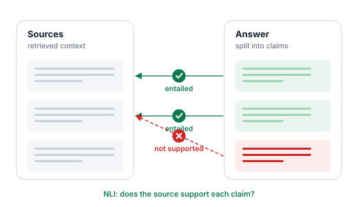

::: {.synthesis}
{fig-alt="Hallucination guardrail: each claim of the answer is checked by NLI against the sources; unsupported claims are blocked"}
:::

::: {.in30}
- A grounded answer stays faithful to trusted sources; a hallucination is an unsupported claim, to stop before users see it.
- The NLI validator splits the output into sentences, retrieves source chunks by embedding similarity, and labels each claim entailment, contradiction or neutral.
- Test with the validator alone; in production, wrap it in a guard between the app and the LLM, with streaming, logging and errors handled.
:::

::: {.concepts}
::: {.concept}
`Groundedness`

Groundedness means the model’s statements stay faithful to trusted sources instead of inventing details. In practice, it is the main test for whether an answer is safe to show to the user.
:::
::: {.concept}
`NLI validator`

Natural language inference labels a claim as entailment, contradiction, or neutral relative to a source. That makes it a practical way to judge whether a generated sentence is supported.
:::
::: {.concept}
`Validator pipeline`

The validation flow usually splits the output into sentences, retrieves relevant source chunks with embeddings and cosine similarity, then runs NLI on each claim against evidence. This turns a long response into checkable pieces.
:::
::: {.concept}
`Guard vs validator`

A validator checks a single output, while a guard wraps one or more validators between the app and the LLM. Guards are better for production because they can combine checks, handle streaming, logging, and errors.
:::
:::

## Why groundedness matters

Groundedness means the model stays faithful to trusted sources. In a RAG (retrieval-augmented generation) system, the model should use the shared data, not make things up. Hallucinations are unsupported claims. This guardrail is meant to stop those claims before they reach the user.

::: {.column-margin .define label="Hallucination"}
A hallucination is an unsupported model claim. The guardrail’s purpose is to detect and stop these claims before they reach the user interface.
:::

```{mermaid}
flowchart LR
    A[Trusted sources<br/>shared data, documents, knowledge base] --> B[Model input]
    B --> C[Model output]

    C --> D{Check groundedness}
    D -->|Supported by sources| E[Grounded response]
    D -->|Not supported| F[Hallucinated response]
```

::: {.example}
**Pizza shop chatbot.** A chatbot for a pizza shop answers a customer question. Instead of using the shared data drive, it invents a recipe that is not in the data. That is a hallucination, because the answer is not grounded in the trusted source.
:::

## Build the NLI validator

An NLI validator checks if a model claim is supported by a source. NLI means **natural language inference**. It classifies a claim as:

- **Entailment**: the source supports the claim
- **Contradiction**: the source says the opposite
- **Neutral**: the source does not give enough evidence

### Validator pipeline

The pipeline has three main steps:

1. **Split the LLM output into sentences**.
2. **Retrieve the most relevant source chunks** with embeddings and cosine similarity.
   - **Embeddings** turn text into vectors.
   - **Cosine similarity** measures how close two vectors are.
3. **Send each claim and the retrieved source chunks to an NLI model**.
   - The chatbot uses the retrieved source chunks from the retrieval step as evidence.
   - The model decides if the claim is entailment, contradiction, or neutral.

```{mermaid}
flowchart TD
    A[LLM output] --> B[Split into sentences]
    B --> C[Make an embedding for each sentence]
    C --> D[Retrieve the most relevant source chunks]
    D --> E[Score chunks with cosine similarity]
    E --> F[Send claim + chunks to NLI model]
    F --> G{NLI result}
    G --> H[Entailment]
    G --> I[Contradiction]
    G --> J[Neutral]
```

::: {.example}
**Testing the validator.** A test claim like “the sun rises in the east” should be marked as entailment. A claim like “the sun rises in the west” should be marked as contradiction.
:::

## Turn validation into a guard

A **validator** checks one output. A **guard** wraps one or more validators and sits between your app and the LLM. This is useful because you can:

- combine multiple guardrails in one execution step
- validate streamed output in real time
- expose an OpenAI-compatible endpoint through the guard
- get logging and error handling out of the box

Using a validator directly is best for testing and debugging. Wrapping it in a guard is better for production.

### Build the hallucination guard

The hallucination validator uses:

- the **`all-MiniLM-L6-v2`** embedding model
- the **GuardrailsAI fine-tuned NLI provenance model** as the entailment model, again as our default value

It checks whether LLM text is grounded in trusted documents. In this lesson, the validator is configured to **throw an exception when it detects a hallucination**.

::: {.steps}
1. **Create the guard**: use `guard.use(...)` by copying the class of our hallucination validation.
2. **Keep the same models**: use `all-MiniLM-L6-v2` for embeddings and the GuardrailsAI fine-tuned NLI provenance model for entailment.
3. **Serve the guard**: the server is already set up for you to use the validator that you just implemented; for your own setup, add the validator to the server configuration file.
4. **Send chatbot traffic through the guard**: use a guarded client with a different `base_url` that points LLM API calls to the guard server, which is currently only running the hallucination guard.
5. **Handle failures in your app**: catch validation exceptions if you want to show a friendlier message, and for real use you don’t need to rely on the detailed validation failure messages.
:::

### What happens at runtime

When the chatbot response goes through the guarded server, the guard checks it before the answer reaches the user. If the reply is grounded, it passes. If it is not grounded, the guard blocks it and returns a validation failure.

```{mermaid}
flowchart LR
    A[Client sends prompt] --> B[Guard / server]
    B --> C{NLI groundedness check}
    C -->|Pass| D[Chatbot response returned]
    C -->|Fail| E[Validation error]
    D --> F[Shown to user]
    E --> F
```

::: {.example}
**Blocking a hallucinated pizza answer.** A user asks for “how to make your own pizza.” The chatbot starts to give instructions, but those instructions are hallucinated. Through the guarded client and server setup, the guard rejects the reply at runtime instead of showing it to customers, and the chatbot can produce a detailed error message for a validation failure.
:::

A useful detail: a sentence can be **true** and still fail the guard if it is **not grounded** in the trusted sources. In the toy example, “the sun is a star” is factual, but it still fails because the source set only supports statements like “the sun rises in the east,” “the sun sets in the west,” and “the sun is hot.” Before that, the guard is tested on “the sun rises in the east,” which passes, and then on “the sun is a star,” which fails because it is true but unsupported by the guard’s sources.

::: {.callout-tip}
## Remember
- Groundedness means supported by sources, not just sounding plausible.
- Use NLI to classify claims as entailment, contradiction, or neutral.
- Break model output into sentence-level claims before checking them.
- Retrieve source chunks first; validate against evidence, not memory.
- Use a validator for testing, and a guard for production enforcement.
:::

<details class="quiz">
<summary>"The sun is a star" is true. Why does the guard reject it?</summary>

Because it is not grounded: the trusted sources only support statements like “the sun rises in the east” or “the sun is hot”. Groundedness means supported by the sources, not true in general.

</details>

<details class="quiz">
<summary>What are the three steps of the NLI validator pipeline?</summary>

Split the output into sentences, retrieve the most relevant source chunks with embeddings and cosine similarity, then run NLI on each claim against that evidence.

</details>

<details class="quiz">
<summary>When do you use the validator directly, and when a guard?</summary>

The validator for testing and debugging; a guard in production, where it can combine checks, validate streams, and handle logging and errors.

</details>

## Sources {.sources}

- [Lesson: Checking for hallucinations with natural language inference](https://learn.deeplearning.ai/courses/safe-and-reliable-ai-via-guardrails/lesson/p1nyu/checking-for-hallucinations-with-natural-language-inference-)
- [Lesson: Using hallucination guardrail in a chatbot](https://learn.deeplearning.ai/courses/safe-and-reliable-ai-via-guardrails/lesson/j85wm/using-hallucination-guardrail-in-a-chatbot)
