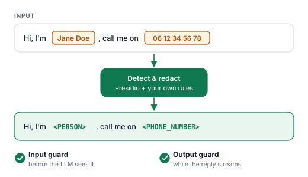

::: {.synthesis}
{fig-alt="PII guardrail: names and phone numbers are detected and replaced by placeholders, on input and on output"}
:::

::: {.in30}
- PII can leak both ways: user data sent to a third-party model or written to logs, and personal data shown back to users.
- Presidio's analyzer finds entities such as names and phone numbers; its anonymizer replaces them and keeps the text usable.
- A custom validator blocks sensitive input before the model; a streaming guardrail redacts PII-looking output before it is displayed.
:::

::: {.concepts}
::: {.concept}
`PII and leakage`

PII is any data that can identify a person, such as names, phone numbers, or email addresses. In an LLM app, PII can leak on the way in through prompts and logs, or on the way out through model responses shown to users.
:::
::: {.concept}
`Microsoft Presidio`

Presidio is used to detect personal data in text and anonymize it before the text reaches an LLM. Its analyzer finds entities and its anonymizer replaces them with safer text while preserving readability.
:::
::: {.concept}
`Custom input validator`

An input validator checks user messages before they are sent to the model or stored. It compares detected entity types against an allowed list and can fail fast with metadata when sensitive data appears.
:::
::: {.concept}
`Output guardrail`

A hub-based guardrail can inspect responses as they stream back from the model. This allows the app to redact or block sensitive-looking output before it becomes visible to the user.
:::
:::

## Why PII matters

PII stands for **personally identifiable information**. This is data that can identify a person, such as a phone number, email address, or name plus other details.

LLM apps can leak PII in two main ways:

- **Input leakage**: the user sends sensitive data into the app, and the app passes it to a third-party model or stores it in backend logs.
- **Output leakage**: the model returns sensitive data, and the app shows it to the user.

This risk is higher when an app uses:

- **Third-party model calls**: the request may leave your app before you can fully control it.
- **Retrieved context**: the app may add extra data from documents, databases, or memory, and that context can include personal data.

The two goals are simple:

1. **Block sensitive input before it leaves the app.**
2. **Prevent sensitive output from reaching the user.**

::: {.example}
**Hank Tate’s phone number.** Hank Tate types his phone number into a chat app. The concern is not only the message itself, but also that the phone number may be stored in backend logs or sent to an external model call.
:::

```{mermaid}
flowchart TD
    U[User types PII] --> A[LLM app]
    A -->|Third-party model call| M[External model]
    A -->|Backend logs / storage| L[Logs]
    M -->|Sensitive output| O[User sees output]

    U -->|Sensitive input leakage| I1[Block before it leaves the app]
    O -->|Sensitive output leakage| I2[Block before it reaches the user]
```

## Detect and redact with Presidio

Microsoft Presidio helps you find personal data in text and replace it before it reaches an LLM. It has two main parts:

- **Analyzer**: detects entities such as **person**, **phone number**, and **date time**.
- **Anonymizer**: replaces those entities with safe text, while keeping the rest of the sentence usable.

Each organization chooses which entity types matter. For one app, a phone number may be sensitive. For another, a date or a person’s name may also matter. You decide what to detect and what to redact.

::: {.column-margin .define label="Your PII policy"}
Not every type of PII matters equally in every app. Each organization decides which entities to detect, redact, or reject, such as phone numbers, dates, or names.
:::

::: {.example}
**Turning personal details into safe text.** An input like “My name is Hank Tate and my phone number is ...” is analyzed for person and phone number, then anonymized so the private parts become safe labels like “Person” and “Phone number” while the rest of the text stays usable.
:::

::: {.compare}
::: {.col .bad}
**Before redaction**

The text still contains personal data, such as names, phone numbers, or dates. If you send it to an LLM, that data can leak.

Example:
“My name is Hank Tate and my phone number is ...”
:::

::: {.col .good}
**After redaction**

Presidio detects the entity types you care about, then replaces them with anonymized text. The meaning stays useful, but the sensitive details are removed.

Example:
“Person” and “Phone number”
:::
:::

## Build an input validator

A custom input validator checks the user message before it goes to the model or gets stored. It calls the PII detector, then checks the detected entity types against an allowed list. If it finds a person name or a phone number, it fails and returns metadata about the violation.

### How the validator works

::: {.steps}
1. **Receive the input text**: the app gets a user message.
2. **Run PII detection**: the validator calls the PII detector on the text.
3. **Check entity types**: it compares the detected entities with the allowed types.
4. **Block sensitive data**: if the text contains a **person** or **phone number**, the validator fails.
5. **Return metadata**: the failure includes metadata so the app knows what was found.
:::

```{mermaid}
flowchart TD
    A[User input] --> B[Validate input]
    B --> C{PII detector finds\nallowed entities only?}
    C -->|Yes| D[Pass]
    C -->|No: person or phone number| E[Fail with metadata]
    E --> F[Block before model call]
    E --> G[Block before storage]
```

::: {.example}
**Blocked before the model.** A user sends a message that includes **Hank Tate** and a **phone number**. The validator detects both personal data types, fails with metadata, and stops the message before it is sent to the model or written to storage.
:::

## Guard outputs in real time

Use a **Hub-based guardrail** on the output side to inspect what the model is about to show the user. A **streaming validator** checks the text as it arrives, not only after the full answer is done. This lets the app **redact** sensitive-looking data or **block** the output before it reaches the screen.

::: {.column-margin .watch}
A model can invent PII-looking content during generation. Do not assume output is safe just because the user did not type sensitive data. Always validate the output stream before rendering it.
:::

This matters because a model can generate text that looks like personal data, even when it was not in the prompt. For example, it may produce phone-number-like strings. The guardrail can catch those numbers during streaming and stop them from being displayed as-is.

```{mermaid}
flowchart LR
    A[User prompt] --> B[LLM generates text]
    B --> C[Streaming output validator]
    C -->|Safe text| D[Display to user]
    C -->|PII-like text| E[Redact or block]
    E --> D
```

::: {.example}
**Streaming phone numbers.** A user asks GPT for a short reply. The model starts streaming text and includes generated phone numbers in the response. The output guardrail checks the stream in real time and sanitizes the sensitive-looking numbers before the user sees them.
:::

### How the output guardrail works

The app does not wait for the full response if it can inspect tokens as they stream. Instead, it applies the guardrail to each chunk of generated text. If the chunk looks like personal data, the app can replace it with redaction text or stop the response entirely.

::: {.callout-tip}
## Remember
- PII can leak in both directions: into the model and back out to the user.
- Detect sensitive data before sending text to an LLM or saving it.
- Redaction is useful when you want to preserve meaning without exposing the raw data.
- Streaming output checks help stop sensitive-looking text before it hits the screen.
- Your PII policy should be based on what is sensitive for your app, not a one-size-fits-all list.
:::

## Sources {.sources}

- [Lesson: Ensuring no personal identifiable information (pii](https://learn.deeplearning.ai/courses/safe-and-reliable-ai-via-guardrails/lesson/wjgpn/ensuring-no-personal-identifiable-information-(pii)
