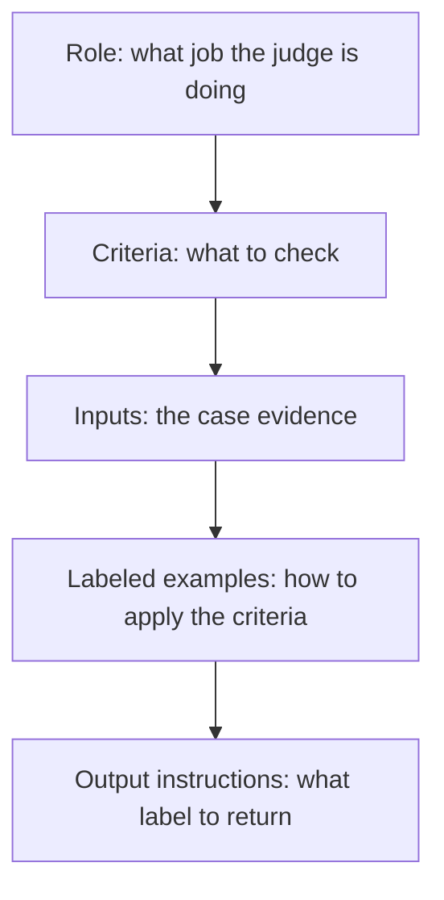

::: {.lesson-meta}
[Evaluation & Guardrails]{.pill .t-eval} [Evaluating LLMs]{.pill .muted}
:::

::: {.tldr}
This page explains how to automate evaluation of LLM applications with a judge model and a custom rubric, especially when judgments depend on context rather than simple output matching. It shows how to separate the judge model, rubric, and evaluation data so you can swap or compare components independently, then defines how to write a clear rubric that tells the judge what to inspect, which evidence to use, and how to report results. The page finishes with an operational workflow: pull recorded runs, assemble the right evidence, run the judge, and review the resulting scores and explanations to understand whether the app behaved well in realistic situations.
:::

::: {.concepts}
::: {.concept}
`LLM judge`

An LLM judge evaluates recorded runs against written criteria instead of only checking final outputs. It can be used for human-style review or automated scoring, and it should consider context like user intent, agent decisions, and tone.
:::
::: {.concept}
`Separation of model, rubric, and data`

Phoenix keeps the judge model, rubric, and examples independent so each can be changed without rewriting the others. That makes it easier to compare models, revise criteria, and understand how the evaluation changes.
:::
::: {.concept}
`Custom rubric`

A rubric defines exactly what the judge should evaluate, what evidence it should use, and how it should report the outcome. Making it explicit avoids vague judgments like “is this good?” and improves consistency.
:::
::: {.concept}
`Five-part rubric structure`

A strong rubric includes Role, Criteria, Inputs, Output, and Evaluation context/format details. These sections help the judge know its task, the standards it should apply, the data it can consult, and the shape of the result.
:::
::: {.concept}
`Operational evaluation loop`

Evaluation is a repeatable process: retrieve runs, prepare the needed evidence, configure the evaluator with the judge and rubric, and run the scoring. The results can then be reviewed to assess behavior in context.
:::
:::

## How a judge works

An LLM judge is a model that evaluates recorded runs against written criteria. It can be used either as a **human review** or as an **automated LLM judge**. In both cases, the point is not just to check the app output, but to judge things like whether the response was **helpful**, whether it answered the user’s **actual question**, and whether the tone was appropriate for a **frustrated user**. It also uses contextual evidence from the run, such as the user input, the agent’s decision, and other needed data. Then it returns a structured judgment that you can store and inspect later.

For the shelter example, the written explanation focuses on the safe-matching case: the agent recommends a dog that lunges at children for a volunteer who is described as an experienced handler. The judge must look at more than the word “experienced.” It has to compare the dog’s behavior risks with the volunteer’s relevant experience and decide whether that experience is enough to make the match safe.

::: {.example}
**Safe match, or not?** A shelter app recommends a dog that lunges at children for a volunteer who is an experienced handler. The judge sees the dog’s record, the volunteer’s profile, and the agent’s recommendation. It must decide whether the volunteer’s experience is enough to manage that specific risk, or whether the match is still unsafe.
:::

```{mermaid}
flowchart LR
  A[Run data<br/>input, output, context] --> B[Rubric<br/>written criteria]
  B --> C[Judge model]
  A --> C
  C --> D[Structured judgment<br/>label, score, explanation]
  D --> E[Save back to Phoenix]
```

### What the judge uses

The judge needs three things:

- a **judge model**: the LLM that makes the evaluation
- a **rubric**: the criteria and instructions for the evaluation
- **run data**: the evidence for that specific example

For safe matching, the rubric can tell the judge to:

1. identify the dog’s behavior risks
2. compare those risks with the volunteer’s relevant experience
3. return **SAFE** only when the volunteer appears able to manage those risks

Phoenix keeps the **model, rubric, and data separate**, so you can change one without changing the others. That means you can swap the judge model while keeping the same rubric and examples, or revise the rubric while keeping the same model and examples, and compare how the judgments differ.

You do not have to use the same model for the judge that you use in the application. For the application, you might choose a faster, less expensive model to keep response times and costs down. But the judge can often evaluate completed runs afterward, so you may choose a more capable model for better evaluation quality, even if it is slower or more expensive. Mistakes by the judge affect your evaluation results, so how reliably it applies the rubric matters.

The judge’s model can also come from a **different provider** than the application’s model. Using the same provider can create shared-bias risk, where both systems make similar mistakes in how they generate or evaluate responses. Choosing a different provider for the judge can help reduce that risk.

Before writing a rubric from scratch, check whether Phoenix already has a built-in evaluator that fits your need. Phoenix templates cover things like **correctness**, **tool selection and tool invocation**, **document relevance**, and **refusal**. For the shelter safe-matching task, though, you will likely need a **custom rubric** that captures the shelter-specific idea of whether the volunteer can safely handle that particular dog.

### How the results are used

Once you have the model and rubric, you can run the judge across a set of recorded runs. The workflow is:

1. retrieve the relevant spans from Phoenix as a dataframe
2. prepare the inputs the judge needs
3. set up the evaluator with the judge model and rubric
4. run the evaluator across the recorded runs
5. save the results back to Phoenix

For safe matching, the judge needs the **volunteer profile**, the **dog record**, and the **agent recommendation**. In code, remember that the judge itself makes LLM calls, so you should use `suppress_tracing` during evaluation to prevent the grading traces from being recorded alongside the application runs.

The judge then returns a **structured result**, such as a label, score, and explanation. Save those results back to Phoenix as annotations linked to the runs they evaluated, so you can find the responses the judge flagged and inspect what happened. That lets you sort by score or filter by label, such as **UNSAFE**, and open the relevant traces to review them more closely.

## Choose the judge model

Phoenix keeps the model, rubric, and data separate. This means you can change one without changing the others. You can try another model with the same rubric and examples. Or you can revise the rubric while keeping the model and examples the same. This helps you compare evaluations and see how the judgments differ.

You do **not** have to use the same model for the judge that you use in the application. A common setup is to use a **faster, less expensive model** in the application, so response times and costs stay down. Then you can use a **more capable model** as the judge, even if it is slower or more expensive, because it can evaluate completed runs afterwards. Mistakes by the judge affect your evaluation results, so how reliably it applies the rubric matters.

The judge model can also come from a **different provider** than the application model. If both models come from the same provider, they may share biases in how they generate and evaluate responses, so they may overlook similar problems. Using a different provider can help reduce that risk.

What matters most is whether the judge applies your criteria correctly. To check that, compare its judgments with **human judgments** of the same responses using the same criteria. In this course, the human is the **Reviewer** and the automated system is the **Evaluator**. Later, you will look at how well the Evaluator agrees with those Reviewers.

Next, consider where the rubric will come from. Before writing one from scratch, check whether Phoenix already has an evaluator for the requirement you want to measure. Built-in templates cover questions such as **correctness, tool selection and tool invocation, document relevance, and refusal**.

::: {.compare}
::: {.col .bad}
**Application model only**

You may optimize for speed and cost, but you do not check whether the evaluation model can judge the outputs reliably.
:::

::: {.col .good}
**Application model + separate judge model**

Use a fast, cheap model in the app, and a slower or more capable judge model for evaluation. Compare the judge with human Reviewers to check reliability.
:::
:::

::: {.example}
**A faster app, a stronger judge.** Your application uses a fast, low-cost model to answer users quickly. For evaluation, you choose a slower, more capable model as the judge. You then compare that judge’s decisions with human Reviewers on the same responses to see whether the judge follows the rubric well.
:::

## Write the rubric

A custom rubric tells the judge **what to evaluate**, **what evidence to use**, and **how to report the result**. If you only ask, “Is this a good response?”, the judge must decide what “good” means by itself. So make the rubric explicit.

### Five parts of a custom rubric

A good rubric has five labeled parts:

1. **Role**: tells the judge what job it is doing.
2. **Criteria**: says what counts as a good or bad result.
3. **Inputs**: gives the case information the judge should use.
4. **Labeled examples**: shows how to apply the criteria.
5. **Output instructions**: says what label or score the judge should return.

::: {.steps}
1. **Write the role**: name the task clearly. A sentence or two is usually enough.
2. **List the criteria**: separate each evaluation dimension. Do not cram many checks into one question. If you need to treat different failures differently, say so: for example, an unsafe result should be treated as more serious than missing a preference or other lower-priority guardrail.
3. **Add the inputs**: label each source of information so the judge can tell what came from where. Put the case information in the same prompt as the instructions, but clearly separate it from the rubric itself—ideally by placing each input inside tags that mark where it begins and ends.
4. **Include labeled examples**: use reviewed cases with the evidence, the expected label, and the reason. Make sure reviewers agree on the labels before you use the cases as examples.
5. **Define the output**: choose clear labels or scores, and say exactly when to use each one. If you use a score from 1 to 10, define what makes a 6 different from a 7; otherwise the scoring is hard to use.
:::

::: {.example}
**Safe matching rubric.** A shelter wants to check whether a volunteer-dog match is safe. The rubric says the judge is evaluating whether a proposed volunteer-dog match is safe for both the volunteer and the dog. The criteria say to check whether the volunteer can physically handle the dog, has experience relevant to the dog's needs, and can manage the behavior risks in the dog's record. The output labels are **SAFE**, **UNSAFE**, and **NEEDS_REVIEW**. For example, the rubric can require **NEEDS_REVIEW** for a large dog when the volunteer has some experience, but no history with large breeds, and the rubric should explicitly tell the judge to use **NEEDS_REVIEW** for those cases.
:::

### Keep the role, criteria, and inputs separate

The judge should not have to guess which text is instruction and which text is case data. Put the case information in a clearly marked section, and keep it separate from the rubric instructions. If relevant evidence is missing, the judge may not be able to apply the criteria reliably.



### A prompt structure you can reuse

| Part | What it should do |
|---|---|
| Role | Name the task clearly, such as judging whether a volunteer-dog match is safe. |
| Criteria | Define the checks, such as physical ability, relevant experience, and behavior risk. |
| Inputs | Label each input, such as the volunteer profile, the dog's record, and the agent's recommendation. |
| Labeled examples | Show safe and unsafe cases, including hard cases where the label is not obvious. |
| Output instructions | Say whether the judge should return SAFE, UNSAFE, or NEEDS_REVIEW, and define each label. |

### Good practices for rubrics

::: {.compare}
::: {.col .bad}
**One rubric for everything**

You ask one judge to decide safety and politeness in the same pass. If it fails, you do not know which problem caused it.
:::
::: {.col .good}
**One dimension per evaluator**

Use one clear question for each evaluator, such as “Is this match safe?” and “Did the agent respond politely?” Then combine the results with the rule your application needs.
:::
:::

Treat your rubric like code. Keep a record of each version and its results. When you revise it, change one thing at a time and test it on the same cases. Keep earlier versions so you can go back if a change makes the judgments worse.

::: {.callout-warning}
## Watch out

Do not add extra labels or scores unless you can explain what each one means and why you need it. Also, examples can help, but they can pull the judge toward similar cases instead of the actual criteria. If you add labeled examples, include both SAFE and UNSAFE cases, especially the harder ones, and compare rubric performance with and without examples on the same benchmark cases. Test the rubric with and without examples on the same reviewed cases, especially hard ones.
:::

## Run and review evaluations

Once you have chosen the judge model and written the rubric, you can run the judge on recorded runs.

### Operational loop

1. **Retrieve runs from Phoenix** as a dataframe.
2. **Prepare the evidence** the judge needs for each example.  
   For response checks, this includes the input and output from the run, along with any context needed to apply the rubric.  
   For safe matching, you need the volunteer profile, the dog's record, and the agent's recommendation.
3. **Set up the evaluator** with your judge model and the rubric that it will apply to that evidence.
4. **Suppress tracing** while the judge runs. The judge also calls an LLM, and those calls can create traces of their own. Use `suppress_tracing` around the evaluation code to pause that recording while the judge runs, so tracing does not add grader traces alongside the application runs you're evaluating.
5. **Run the evaluator** across the recorded runs.
6. **Save the judgments back to Phoenix** as annotations linked to the runs.

```{mermaid}
flowchart LR
  A[Phoenix runs] --> B[Retrieve as dataframe]
  B --> C[Prepare input, output, and context]
  C --> D[Judge model + rubric]
  D --> E[Run evaluation batch]
  E --> F[Structured result: score, label, explanation]
  F --> G[Save annotations to Phoenix]
  G --> H[Filter by score or label]
  H --> I[Open traces for review]
```

The judge returns a structured result, such as a safe or unsafe label, a score, and an explanation. Save those results back to Phoenix so you can find the responses the judge flagged and inspect what happened.

::: {.example}
**Filtering unsafe recommendations.** You run the judge over safe matching examples and then filter the saved annotations for responses labeled `UNSAFE`. You open one trace and compare the volunteer's profile, the dog's record, and the agent's recommendation to see which risk the agent may have overlooked. The judge receives the volunteer's profile, the dog's record, and the agent's recommendation for each safe matching example.
:::

Now you can sort by score or filter by label to find the responses you want to inspect. For safe matching, a good starting point is recommendations labeled `UNSAFE`. These labels give you an explanation of what failed, so you can focus human review on the most likely problems instead of reading every response.

::: {.callout-tip}
## Remember
- Judging should be context-aware, not just output-aware.
- Keep the judge model, rubric, and data separate so you can swap them independently.
- Write the rubric explicitly; don’t leave “good” to the model’s guesswork.
- A good rubric tells the judge what to evaluate, what evidence to use, and how to respond.
- Use recorded runs and review the results to compare behavior across cases and models.
:::

## Sources {.sources}

- [Lesson: Using an llm judge](https://learn.deeplearning.ai/courses/evaluating-and-improving-agentic-applications/lesson/hl9qj2/using-an-llm-judge)
- [Lesson: Writing a custom rubric](https://learn.deeplearning.ai/courses/evaluating-and-improving-agentic-applications/lesson/pu28bj/writing-a-custom-rubric)
