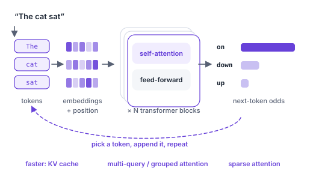

::: {.synthesis}
{fig-alt="How a transformer LLM works: tokens, embeddings with position, N transformer blocks, next-token probabilities, repeated"}
:::

::: {.in30}
- A transformer LLM turns text into tokens, then embeddings with positional information, and runs them through stacked blocks to predict the next token.
- Self-attention lets each token weigh the others; most modern LLMs keep only the decoder, built for next-token prediction.
- Generation is sped up by a KV cache and attention variants: multi-query, grouped query and sparse attention.
:::

::: {.concepts}
::: {.concept}
`Tokenization`

Tokenization breaks text into tokens. A token can be a whole word or a smaller piece of a word, depending on the tokenizer.
:::

::: {.concept}
`Embeddings`

Embeddings are learned vectors that turn token IDs into numbers the model can work with. They give tokens a usable representation, but they do not yet add context.
:::

::: {.concept}
`Self-attention`

Self-attention measures how relevant each token is to the others in the current context. This is what lets a transformer connect words across a long sentence or paragraph.
:::

::: {.concept}
`Transformer block`

A transformer block is the repeated building unit of the model. It combines multi-head self-attention with a position-wise feed-forward network, and residual connections plus layer normalization are standard parts around those sublayers.
:::

:::

## From text to vectors

### From words to tokens to embeddings

Before transformers, language models often used **bag-of-words**. This method treats text as an unordered collection of words. It ignores word order, so it loses a lot of meaning.

Then came **Word2Vec**, a word embedding method. An embedding is a learned vector that represents a word in numerical form. Similar words tend to get similar vectors.

Transformers improved on this by keeping context. They do not just assign one fixed meaning to a word. They change the representation based on the surrounding tokens.

### The transformer workflow

The usual workflow is:

1. Split text into tokens.
2. Convert tokens to embeddings.
3. Add positional information.
4. Send the sequence through stacked transformer layers.
5. Use a final linear layer and softmax to produce next-token probabilities.

Positional information matters because attention alone does not know token order. It tells the model where each token appears in the sequence.

Most modern large language models use only the **decoder** side of the original transformer design. They are built for text generation, so they predict one next token at a time.

## Inside the transformer

### Self-attention, explained simply

Self-attention is the mechanism that tells the model which tokens matter to each other.

At a high level, each token produces three things:

- **Query**: what the token is looking for.
- **Key**: what the token offers to others.
- **Value**: the information passed along if the token is relevant.

The model compares queries with keys to get relevance scores. It then uses those scores to blend the values.

This helps transformers track relationships across distant words. For example, the model can connect a pronoun to the noun it refers to, even if several words separate them.

### Inside a transformer block

A transformer block is the repeated core of the model. Standard blocks are stacked many times.

Each block usually contains:

- multi-head self-attention
- a position-wise feed-forward network
- residual connections
- layer normalization

Multi-head attention means the model runs several attention heads in parallel. Each head can focus on different kinds of relationships. One head might track syntax, while another tracks long-range meaning.

The feed-forward network acts on each token position separately. It transforms the features after attention has mixed context across the sequence.

Residual connections add the input of a sublayer back to its output. Layer normalization then helps stabilize the activations. These are standard support parts of the block, not optional extras.

### Decoder-only vs encoder-decoder transformers

The original transformer had two stacks:

- an **encoder** stack
- a **decoder** stack

Both stacks used repeated layers. The decoder had one extra trick: it used **masked self-attention**, which prevents a token from looking at future tokens during generation. In the original encoder-decoder design, the decoder also used **cross-attention** to read the encoder output.

Modern LLMs usually keep only the decoder stack. This is enough for next-token prediction, which is the main task in text generation.

## Generating faster

Generating text token by token can be expensive. Several techniques reduce that cost.

::: {.column-margin .define label="KV cache"}
A KV cache stores key and value tensors from earlier tokens during generation. Reusing them avoids recomputing the same attention work at every new step.
:::

**KV cache**  
During generation, the model does not need to recompute keys and values for earlier tokens. It stores them in a cache and reuses them for the next step.

**Multi-query attention**  
This variant shares key and value projections across many query heads. It reduces memory use and compute.

**Grouped query attention**  
Grouped query attention is a middle ground between full multi-head attention and full multi-query attention. Query heads are split into groups that share key/value projections. This lowers KV-cache cost while keeping more quality than fully shared keys and values.

**Sparse attention**  
Sparse attention attends only to selected tokens instead of all tokens. That lowers computation for long sequences.

## In code: Hugging Face Transformers

A practical way to explore transformers is with the Hugging Face Transformers library. For inference, the basic pattern is: load a tokenizer, load a causal language model, tokenize the prompt, generate tokens, then decode the output.

::: {.code-step title="Generate text with GPT-2"}
```python
from transformers import AutoTokenizer, AutoModelForCausalLM

model_name = "gpt2"

tokenizer = AutoTokenizer.from_pretrained(model_name)
model = AutoModelForCausalLM.from_pretrained(model_name)

prompt = "Transformers work by"
inputs = tokenizer(prompt, return_tensors="pt").to(model.device)   # inputs on the same device as the model

outputs = model.generate(**inputs, max_new_tokens=50)
text = tokenizer.decode(outputs[0], skip_special_tokens=True)

print(text)
```
:::

This example shows the main inference loop:

- `AutoTokenizer` converts text into token IDs.
- `AutoModelForCausalLM` loads a causal language model for next-token prediction.
- `model.generate(...)` produces new tokens.
- `tokenizer.decode(...)` turns token IDs back into readable text.

If you want to use a GPU or other accelerated device, a current loading pattern is to let the library place the model automatically:

::: {.code-step title="Let the library place the model on a GPU"}
```python
from transformers import AutoTokenizer, AutoModelForCausalLM

model_name = "gpt2"

tokenizer = AutoTokenizer.from_pretrained(model_name)
model = AutoModelForCausalLM.from_pretrained(model_name, device_map="auto")

prompt = "Transformers work by"
inputs = tokenizer(prompt, return_tensors="pt").to(model.device)   # inputs on the same device as the model

outputs = model.generate(**inputs, max_new_tokens=50)
text = tokenizer.decode(outputs[0], skip_special_tokens=True)

print(text)
```
:::

::: {.callout-tip}
## Remember
- Tokens are the units the model actually processes, not raw characters or full words every time.
- Embeddings give tokens numeric vectors, but context comes from attention.
- Most modern LLMs are decoder-only transformers.
- The transformer block repeats the same core pattern many times.
- KV cache and attention variants reduce inference cost, especially for long generations.
:::

<details class="quiz">
<summary>Why does a transformer need positional information?</summary>

Attention alone does not know the order of tokens: positional information tells the model where each token appears in the sequence.

</details>

<details class="quiz">
<summary>In self-attention, what are the query, the key and the value?</summary>

The query is what a token is looking for, the key what it offers to others, the value the information passed along if it is relevant. Queries are compared with keys to blend the values.

</details>

<details class="quiz">
<summary>What does a KV cache avoid recomputing?</summary>

The keys and values of earlier tokens: they are stored during generation and reused at each new step.

</details>

## Sources {.sources}

- [How Transformer LLMs Work](https://www.deeplearning.ai/courses/how-transformer-llms-work)
- [Attention and Transformers](https://courses.cis.cornell.edu/courses/cs4782/2026sp/notes/rawnotes/07_Attention_Transformers/07_Attention_Transformers.md.html)
- [How Transformers Work: Transformer Architecture Explained | DataCamp](https://www.datacamp.com/tutorial/how-transformers-work)
- [Grouped-Query Attention (GQA): shrinking the KV cache](https://zeroentropy.dev/concepts/grouped-query-attention)
