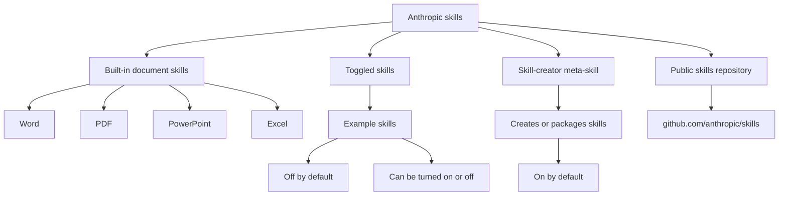

::: {.lesson-meta}
[Toolbox]{.pill .t-tools} [Tools]{.pill .muted}
:::

::: {.tool-facts}
| | |
|---|---|
| **Made by** | Anthropic |
| **Open source** | Partly |
| **Topics** | Agents |
| **Implements** | pre-built skills, skill creation, document skills, workflow automation with skills |
| **Documentation** | <https://github.com/anthropic/skills> |
:::

::: {.tldr}
Anthropic skills are small, reusable task packs that extend Claude with structured workflows for documents and other repeatable jobs. The ecosystem includes built-in document skills for formats like Word, Excel, PowerPoint, and PDF, a set of optional example skills from a public repository, and a special always-on skill-creator that helps generate the folder structure and files for new skills. In practice, you enable the skills you need in Claude Desktop, optionally connect MCP servers for external data or tools, and use skills when a task is repetitive, modular, and benefits from clear instructions and prepared inputs.
:::

::: {.concepts}
::: {.concept}
`Built-in document skills`

These are always available skills for working with Microsoft Docs, PDFs, PowerPoint, and Excel. They are used automatically in Claude AI and are the core document-focused part of the ecosystem.
:::
::: {.concept}
`Optional example skills`

Anthropic also provides example skills that can be turned on or off. These can include scripts, best practices, logos, brand guidelines, and other reusable assets for specific tasks.
:::
::: {.concept}
`Skill-creator`

This meta-skill helps programmatically create new skills by generating the required folder structure and files. It is the one built-in skill that is enabled by default.
:::
::: {.concept}
`Claude Desktop settings`

Skills are managed in Settings > Capabilities, where you can see which skills are enabled and where they live. This is also where pre-built skills are toggled on or off.
:::
::: {.concept}
`MCP server integration`

If a skill needs outside data or tools, you can connect an MCP server in Settings > Developer. Claude Desktop exposes the server command, arguments, and environment variables there.
:::
:::

## What it is

Anthropic skills are small, reusable task packs for Claude. They include built-in document skills, a public skills repository, and a skill-creator meta-skill that helps make new skills.

Some skills are built in and always available in Claude AI, such as the document skills for Microsoft Docs, PDFs, PowerPoint, and Excel. These document skills are the always-used skills in tools like Claude AI. Other Anthropic-made skills are examples that you can toggle on and off in Claude, with the explicit exception of skill-creator, which is on by default. By default, those example skills are off.

The skills repository lives on GitHub at `github.com/anthropic/skills`. Anthropic states that the repository skills list as a whole is ready for production use. You can use them out of the box with Claude AI and Claude Desktop, and you can also install them yourself using tools like Claude Code. The repository’s `skills` folder contains `SKILL.md` files with YAML Frontmatter, including the name and description, and GitHub renders those markdown files for viewing.

::: {.example}
**Excel skill in use.** Claude AI used the Excel skill to create spreadsheets that displayed marketing results. The same Excel skill is one of Anthropic’s pre-built skills, and it can be used in Claude AI and Claude Desktop.
:::



## What it does

Anthropic’s skills cover a few main jobs:

- **Document skills** for **Excel, Word, PowerPoint, and PDF**. These are built in and always used in tools like Claude AI.
- A **skill-creator** skill that can **programmatically create skills** by generating the needed folder structure and files.
- Other example skills that can **load scripts, best practices, and assets** such as **logos** and **brand guidelines**.

These skills are bucketed into two sections: the document skills above, and other example skills that can be toggled on and off in Claude by default, with the exception of **skill-creator**, which is toggled off by default.

With these skills, Claude can do more than answer a question. It can follow a skill file, run helper scripts only when needed, and use extra files to shape the result.

### What a skill can include

A skill can define:

- what the skill is
- what it provides
- best practices to follow
- concrete examples
- reusable content
- a **SKILL.md** file with **YAML Frontmatter** that includes the **name** and **description**
- related files and folders that support the skill’s structure and how it is rendered
- underlying scripts, such as Python scripts to initialize, package, or validate a skill
- assets like logos, colors, fonts, and typography

The source also shows that skills can use **MCP servers** as a data source, for example to read from **BigQuery** instead of CSV files.

::: {.example}
**Turning data into a styled presentation.** Claude uses the PowerPoint skill to take marketing data from BigQuery, then applies a brand guideline skill with logos, colors, and fonts to build a presentation with the right styling.
:::

```{mermaid}
flowchart LR
    A[Read relevant skill files:\nmarketing campaign analysis,\nBigQuery guidelines,\nPowerPoint and brand skills] --> D[Presentation workflow]
    B[Custom skill\nBrand guidelines, logos, fonts] --> D
    C[MCP data source\nBigQuery] --> D
    D --> E[Styled presentation]
```

## How to use it

Use skills as a small workflow in Claude Desktop:

1. Turn on the skills you need in **Settings > Capabilities**. Pre-built skills are off by default. The **skill-creator** skill is on by default. Check which skills are enabled and where they live there in Claude Desktop.
2. If your skill needs outside data or tools, connect an **MCP server** in **Settings > Developer**. In Claude Desktop, you can see the server command, arguments, and environment variables there.
3. Use **skill-creator** to make a new skill or update an existing one. It can package your content into a reusable skill and create the needed `SKILL.md` and folder structure. Afterward, validate the result: make sure a `SKILL.md` exists, check the YAML frontmatter, and verify the folder and file contents are correct.
4. Give Claude the context it needs. For example, provide the data schema, the rules you want to keep, and any files the skill should use. Be intentional with the prompt and context, since skill-creator is effective at generating structure but will not reliably preserve important rules unless you explicitly tell it to.
5. Combine your custom skill with a built-in skill in the same task. Claude can use your skill, an MCP server, and a built-in document skill together. Built-in Excel, PowerPoint, and document skills cannot be toggled on or off; only custom skills are managed through **Capabilities**.

::: {.steps}
1. **Enable the needed skills**: turn on the pre-built skills you want in Settings > Capabilities. Keep **skill-creator** enabled, and check which example skills are available there; the example skills also exist on GitHub and are off by default.
2. **Connect the data source**: in Claude Desktop, add an MCP server when the skill needs external data, such as BigQuery.
3. **Create or update the skill**: ask **skill-creator** to modify an existing skill or build a new one from files and instructions.
4. **Run the combined workflow**: use the custom skill with a built-in skill, such as PowerPoint, to finish the task.
:::

::: {.example}
**BigQuery analysis plus PowerPoint.** You have an `analyzing-marketing-campaign` skill that reads CSV files. You update it so it reads from BigQuery instead, while keeping the budget reallocation rules unchanged. Claude Desktop connects to a local MCP server for BigQuery, and Claude first lists the BigQuery tables, then shows the schema for the table; a small spelling mistake is corrected along the way. You create a second skill for brand guidelines from uploaded files and logos, and then you combine both with the built-in PowerPoint skill to make a presentation. In the update, the schema you just saw is explicitly used to drive the change, while the existing “budget reallocation rules” reference stays unchanged.
:::

```{mermaid}
flowchart LR
  A[Claude Desktop] --> B[Settings: enable skills]
  A --> C[Connect MCP server]
  A --> D[skill-creator]
  D --> E[Update or create skill]
  C --> E
  E --> F[Custom output skill]
  F --> G[Built-in PowerPoint skill]
  G --> H[Finished presentation]
```

## When to use it

Use Anthropic skills when you want a reusable, modular workflow for a repeated task. This fits well for document creation, analysis workflows, or task-specific skills that you may want to run again with small changes.

Skills work best when the prompt is explicit and the input data is well prepared. Anthropic notes that the skill-creator skill helps build the structure, but you still need to give clear instructions and the right context. In Claude settings → capabilities, the example **skill-creator** built-in skill is toggled on by default, while the other example skills are turned off by default. Some skills are built in to Claude and are always available, such as the document skills for Excel and PowerPoint, so they cannot be toggled on or off. Others are optional and can be enabled or disabled.

The workflow is strongest when you combine skills with MCP, the Model Context Protocol, especially when you need external data sources such as BigQuery. In this setup, Claude Desktop connects to a local MCP server, and the MCP configuration includes the command, arguments, and any environment variables or credentials needed to run it. MCP brings in the data, custom skills handle the task logic, and a built-in skill can create the final document.

::: {.example}
**Marketing analysis to branded deck.** Claude starts with a prior marketing campaign analysis skill, updates it to use BigQuery instead of CSVs while keeping the budget reallocation rules reference unchanged, and then creates a separate brand-guidelines skill with a guidelines file and logos. From there, it reads marketing data from BigQuery through MCP, uses the custom analysis and brand-guidelines skills, and creates a branded PowerPoint deck with the built-in presentation skill. In the lesson example, Claude first lists the BigQuery tables, then shows the table schema before updating the skill.
:::

::: {.compare}
::: {.col .bad}
**Built-in skill only**

Use this when the task is already covered by Claude’s built-in document skills, such as PowerPoint. You get the native workflow, but not your own task logic or brand rules.
:::

::: {.col .good}
**Custom skill**

Use this when you need a reusable workflow for a specific task, such as campaign analysis or brand styling. You must provide explicit prompts and good input data.
:::

::: {.col .good}
**MCP-backed workflow**

Use this when the task needs external data, such as BigQuery, plus one or more skills for analysis and document creation. This is the best fit for end-to-end workflows.
:::
:::

::: {.callout-tip}
## Remember
- Skills are best for repeatable, modular workflows.
- Document skills are built in and always used; other examples are optional.
- Skill-creator is on by default and helps build new skills.
- Use clear prompts and well-prepared inputs for best results.
- Connect an MCP server if the skill needs external tools or data.
:::

## Sources {.sources}

- [Lesson: Exploring pre built skills](https://learn.deeplearning.ai/courses/agent-skills-with-anthropic/lesson/cniu9q/exploring-pre-built-skills)
